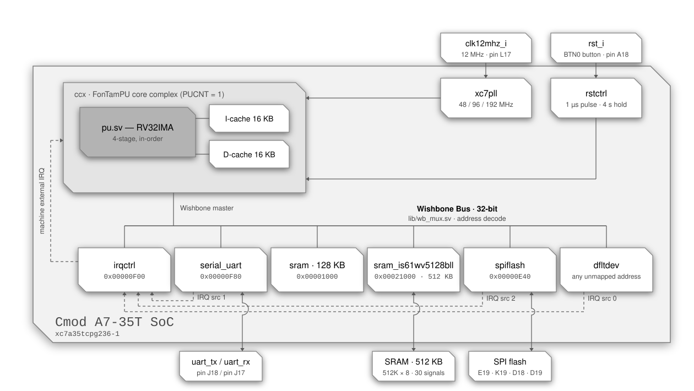

<div align="center">

# RV32 SoC — Cmod A7-35T

**A single-core RISC-V system-on-chip built around the FonTamPU (`ftpu`) core complex,
targeting the Digilent Cmod A7-35T.**


</div>

---

## Contents

- [Overview](#overview)
- [Block diagram](#block-diagram)
- [At a glance](#at-a-glance)
- [Memory map](#memory-map)
- [Device registers](#device-registers)
- [Interrupts](#interrupts)
- [CPU configuration](#cpu-configuration)
- [Clocking](#clocking)
- [Reset behaviour](#reset-behaviour)
- [Pin assignment](#pin-assignment)
- [Building the bitstream](#building-the-bitstream)
- [Loading a program](#loading-a-program)
- [Files](#files)
- [Notes and gotchas](#notes-and-gotchas)

---

## Overview

`cmoda735.sv` is the top level of a compact RV32 SoC: one `ftpu` hart with private
instruction and data caches, a Wishbone peripheral interconnect, an interrupt
controller, a UART console, a SPI master on the configuration flash, 128 KB of on-chip
SRAM, the board's 512 KB asynchronous SRAM, and a *default device* that acknowledges
and reports every access to an address no other device maps.

The program is baked into the on-chip SRAM at synthesis time via `$readmemh`, so the
SoC boots straight into application code at `0x1000`; the on-board SRAM, mapped right
above it, holds the stack, and the heap runs into it. That program can be
[`apps/bootldr`](apps/bootldr), a bootloader which loads the application from the SPI
flash, so that the application changes without a new bitstream and is not bound to the
128 KB of the on-chip SRAM.

---

## Block diagram

<p align="center">
  
</p>

<div align="center">
<sub>Solid lines are Wishbone, clock/reset and I/O paths · dashed lines are interrupt paths</sub>
</div>


---

## At a glance

| | |
| :--- | :--- |
| **Board** | Digilent Cmod A7-35T |
| **FPGA** | Xilinx Artix-7 `xc7a35tcpg236-1` |
| **Harts** | 1 (`CPU_COUNT = 1`) |
| **ISA** | RV32IMA + Zicsr, Machine and Supervisor privilege |
| **Pipeline** | 4-stage in-order, single issue, branch / JAL / RET prediction |
| **Core & bus clock** | 96 MHz, from an MMCM off the 12 MHz oscillator |
| **Bus** | Wishbone, 32-bit data (`XWORDBITSZ = 32`), single master |
| **Caches** | 16 KB I-cache + 16 KB D-cache, direct-mapped |
| **RAM** | 128 KB on-chip BRAM (`SRAM_KBSIZE = 128`) and 512 KB of on-board asynchronous SRAM |
| **On-board SRAM** | ISSI IS61WV5128BLL, 512K × 8, at `0x00021000`, through `dev/sram_is61wv5128bll.sv`: a byte at a time, a word read or write in 13 cycles |
| **Console** | UART, 115200 8N1 by default, 2 KB RX + 2 KB TX buffers |
| **SPI flash** | SPI master on the configuration flash, a 4 MiB Micron N25Q032A or, on current boards, a Macronix MX25L3233F: `cs` high during control words, `miso` sampled on the falling edge, `sclk` on pin `E19`, up to 48 Mbps, 2 KB RX + 2 KB TX buffers |
| **Unmapped access** | Acknowledged by `dfltdev`: reads as `nop`, writes dropped, IRQ source 0 raised, address latched at `0xFFFFFFFC` |
| **Interrupt sources** | 3 — `dfltdev` (0), `serial_uart` (1), `spiflash` (2) |
| **Reset vector** | `0x00001000` |
| **Initial `sp`** | `0x000A1000` (end of the on-board SRAM) |
| **Toolchain** | Vivado 2020.2 · `riscv32-unknown-elf` GCC |

---

## Memory map

All bases and sizes below are **byte** addresses. The interconnect table in
`cmoda735.sv` (`WBPI_SDEVS`) stores them as byte values and `lib/wb_mux.sv`
converts them to word indices internally.

| # | Device | Module | Base | Last | Size | Cached |
| :-: | :--- | :--- | :--- | :--- | ---: | :-: |
| 0 | Interrupt controller | `dev/irqctrl.sv` | `0x00000F00` | `0x00000F03` | 4 B (1 word) | no |
| 1 | UART console | `dev/serial_uart.sv` | `0x00000F80` | `0x00000F87` | 8 B (2 words) | no |
| 2 | On-chip SRAM | `dev/sram.sv` | `0x00001000` | `0x00020FFF` | 128 KB | yes |
| 3 | On-board SRAM | `dev/sram_is61wv5128bll.sv` | `0x00021000` | `0x000A0FFF` | 512 KB | yes |
| 4 | SPI flash | `dev/spi.sv` | `0x00000E40` | `0x00000E47` | 8 B (2 words) | no |
| 5 | Default device | `dev/dfltdev.sv` | *every other address* | — | — | no |
| ↳ | Fault address register | `dev/dfltdev.sv` | `0xFFFFFFFC` | `0xFFFFFFFF` | 4 B (1 word) | no |

```
 0x00000000        · · · unmapped → dfltdev · · ·    address 0 included
 0x00000E3F
 0x00000E40 ┌────────────────────────────────────┐
            │   spiflash · 8 B                   │   0xE40 data · 0xE44 command
 0x00000E47 └────────────────────────────────────┘
 0x00000E48        · · · unmapped → dfltdev · · ·
 0x00000EFF
 0x00000F00 ┌────────────────────────────────────┐
            │   irqctrl · 4 B                    │
 0x00000F03 └────────────────────────────────────┘
 0x00000F04        · · · unmapped → dfltdev · · ·
 0x00000F7F
 0x00000F80 ┌────────────────────────────────────┐
            │   serial_uart · 8 B                │   0xF80 data · 0xF84 command
 0x00000F87 └────────────────────────────────────┘
 0x00000F88        · · · unmapped → dfltdev · · ·
 0x00000FFF
 0x00001000 ┌────────────────────────────────────┐   reset vector = 0x00001000
            │   SRAM · 128 KB · on-chip          │   .text .data .bss
 0x00020FFF └────────────────────────────────────┘
 0x00021000 ┌────────────────────────────────────┐
            │                                    │
            │   SRAM · 512 KB · on-board         │   heap, stack
            │                                    │
 0x000A0FFF └────────────────────────────────────┘   sp starts at 0x000A1000
 0x000A1000        · · · unmapped → dfltdev · · ·
 0xFFFFFFFB
 0xFFFFFFFC ┌────────────────────────────────────┐
            │   dfltdev · fault address · 4 B    │   read OK · write faults
 0xFFFFFFFF └────────────────────────────────────┘
```

### How the decode works

`WBPI_ADDRLIMIT` is `0x1000 + 128 KB + 512 KB = 0xA1000`, and the interconnect sizes its
address bus from that: only bits `[19:2]` of the byte address are carried, with
bits `[31:20]` OR-reduced into a single extra "out of range" bit so
**nothing aliases back into a real device** for any access at or above `0x100000`.

Slave 5 (`dev/dfltdev.sv`) is the catch-all for every address the table does not
claim. It never drives `bsy` and acknowledges every access on the following cycle,
so **an unmapped access always completes**. A read returns the instruction `nop`
(`0x00000013`) and a write is dropped. Both are faults: the address is latched in
the fault address register and interrupt source 0 is raised (see
[Device registers](#default-device--every-unmapped-address)). The only access
to unmapped space that is *not* a fault is a read of the fault address register
itself, at `0xFFFFFFFC`.

Decode is a sequential walk of `WBPI_SDEVS` (`lib/wb_mux.sv`): when an address falls
outside the currently selected device's range, the interconnect — once any
outstanding acknowledgements have drained — restarts at entry 0 and advances one
entry per cycle, holding the bus busy, until it finds the range containing the
address or exhausts the table (which selects the default device). Back-to-back
accesses within one device cost nothing extra; alternating between, say, the UART
and the on-chip SRAM re-walks the table at every switch. The on-board SRAM is the
entry right after the on-chip SRAM; the SPI flash, although mapped below the others,
comes last, so that adding it left the walk to the interrupt controller, the UART and
the two SRAMs as short as it was. The default-device selection is valid only for the
address it was walked for: another address presented in that cycle restarts the walk
rather than being handed the default device.

> [!NOTE]
> The core marks everything outside `[0x1000, 0xA1000)`, the two SRAMs, as
> non-cacheable (`cpu_dcache_miss_w`), so device registers — the fault address
> register included — are always accessed straight through the bus and never sit
> stale in the D-cache.

> [!NOTE]
> The Verilator simulator (`rv32-sim/`) has no default device: its default slave
> never acknowledges, so the same access ends the simulation with a default-slave
> trap instead of raising an interrupt. Interrupt source 0 is reserved there so
> that source numbering matches the FPGA tops.

---

## Device registers

### Interrupt controller — `0x00000F00`

A single 32-bit register. A **write** submits a command, a subsequent **read**
retrieves its result; two memory operations are always needed.

| Word | Layout |
| :--- | :--- |
| write | `arg[31:2]` · `cmd[1:0]` |
| read | `resp[31:3]` · `rsvd[2]` · `cmd[1:0]` |

| `cmd` | Name | Purpose |
| :-: | :--- | :--- |
| `0b00` | `CMDDEVRDY` | Ready the controller for a new command; clears `resp` |
| `0b01` | `CMDACKIRQ` | Acknowledge an IRQ for destination `arg[31:3]`; `arg[2]` enables/disables further delivery. Returns `-1` if raised by `CMDINTDST` (served first), otherwise the source index, or `-2` if none pending |
| `0b10` | `CMDINTDST` | Raise an interrupt at destination `arg[31:3]` (used for IPIs), held pending for it until it acknowledges it; one raised while one is already pending merges with it, hence the command is never refused. The destination `-1` (all ones) requests a system reset instead |
| `0b11` | `CMDENAIRQ` | Enable (`arg[2] = 1`) or disable a given interrupt source `arg[31:3]` |

The controller has accepted a command only when the `cmd` field read back is
`CMDDEVRDY`; otherwise resend `CMDDEVRDY`. Any non-`CMDDEVRDY` command written while
a transaction is in flight is silently dropped, so use an atomic read-modify-write
to stay thread-safe.

Every source and every destination is **disabled at reset**; no source interrupt is
delivered until software enables the source with `CMDENAIRQ` and the destination with
`CMDACKIRQ` (`arg[2] = 1`). An interrupt raised with `CMDINTDST` bypasses both enables.

A `CMDINTDST` targeting the destination `-1` (`arg[31:3]` all ones) is a **system
reset request**: the controller pulses its `rst_rqst_o` output to the reset
controller, which restarts its reset pulse, so every CPU, device and cache resets
and the SoC boots again from `0x1000` with its memory contents intact (see
[Reset behaviour](#reset-behaviour)). The command's result is `-1`, as for any
invalid destination; underLineOS exposes it as `_sysreset()`.

### UART console — `0x00000F80`

| Offset | Address | Register | Description |
| :-: | :--- | :--- | :--- |
| `+0x0` | `0x00000F80` | Data | Read receives one byte, write transmits one byte |
| `+0x4` | `0x00000F84` | Command | Write submits a command, read retrieves the result |

| `cmd` | Name | Purpose |
| :-: | :--- | :--- |
| `0b00` | `CMDDEVRDY` | Make the device accept a new command |
| `0b01` | `CMDGETBUFFERUSAGE` | `arg = 0` → RX bytes used, `arg = 1` → TX bytes used |
| `0b10` | `CMDSETINTERRUPT` | `arg = 0` disables; non-zero enables and sets the RX-usage threshold. Returns the buffer size |
| `0b11` | `CMDSETSPEED` | `arg = PHYCLKFREQ / bitrate`. Returns `PHYCLKFREQ` |

Reset defaults: **115200 baud**, 2048-byte RX and TX buffers (`BUFSZ = 2048`),
**interrupt disabled**. At 96 MHz, `CMDSETSPEED` for 115200 baud takes
`96000000 / 115200 = 833`.

> [!IMPORTANT]
> Reading the data register while the receive buffer is empty holds `wb_bsy_o` — the
> read **blocks** until a byte arrives. That is intentional (it makes `getchar()`
> work), but on a multi-hart build a blocked read holds the bus grant, which is why
> `lib/wb_arbiter.sv` bounds grant duration with `GRANTHELDLIMIT`.

### SPI flash — `0x00000E40`

`dev/spi.sv`, instance `spiflash`, is a SPI master in mode 0 (`CPOL = 0`, `CPHA = 0`) on
the configuration flash of the board, a 4 MiB Micron N25Q032A or, on current boards, a
Macronix MX25L3233F, which it drives through single-bit commands. It transfers a 32-bit
word at a time, most significant bit of least significant byte first: a buffer in
memory goes out, and comes in, in address order. Its registers and commands are those
of the UART console, so the character-device driver `hwdrvchar.h` drives it, every
count in bytes, with `HWDRVCHAR_DATATYPE` defined to `uintptr_t` before including it,
so that `hwdrvchar_read()` and `hwdrvchar_write()` access the data register a word at
a time:

| Offset | Address | Register | Description |
| :-: | :--- | :--- | :--- |
| `+0x0` | `0x00000E40` | Data | Write transmits one word, byte 0 first; read receives one, the first byte received in byte 0. `wb_sel_i` is ignored: a byte or halfword access still moves a whole word |
| `+0x4` | `0x00000E44` | Command | Write submits a command, read retrieves the result |

| `cmd` | Name | Purpose |
| :-: | :--- | :--- |
| `0b00` | `CMDDEVRDY` | Make the device accept a new command |
| `0b01` | `CMDGETBUFFERUSAGE` | `arg = 0` → RX bytes used, `arg = 1` → TX bytes not yet transmitted, counting a paused transmission and a pending close, capped to the buffer size, `0` only when no transmission is in progress; both are multiples of 4 |
| `0b10` | `CMDSETINTERRUPT` | `arg = 0` disables, and **closes** the transmission in progress; non-zero enables and sets the RX-usage threshold in bytes, a threshold between two multiples of 4 being reached at the greater one. Returns the buffer size in bytes |
| `0b11` | `CMDSETSPEED` | `arg = PHYCLKFREQ / bitrate`; sets the highest bitrate `96 MHz / 2n` not above `96 MHz / arg`, from 48 Mbps down to about 100 kbps, `arg = 0` selecting the lowest. Returns `PHYCLKFREQ` |

Reset defaults: **400 kbps**, 2048-byte (512-word) RX and TX buffers (`BUFSZ = 512`),
**interrupt disabled**. At 96 MHz, `CMDSETSPEED` for 24 Mbps takes
`96000000 / 24000000 = 4`.

Transfers are full duplex: while a word written is transmitted on `mosi`, a word is
received from `miso` into the RX buffer. The word written while the TX usage is `0`
begins a **transmission**, which lasts, `cs` low, until it is **closed** with
`CMDSETINTERRUPT` and a null `arg`: it then ends once every word written before that
command has been transmitted. When the TX buffer runs empty before, the transmission
**pauses** — `sclk` idle, `cs` kept, nothing clocked — until the next word written
resumes it, so the words can be written at any pace, preemption included. A close
while no transmission is in progress does nothing, hence the `CMDSETINTERRUPT` which
ends `hwdrvchar_init()` is harmless. The first word of a transmission is a **control
word**: 32 ones are transmitted in its place, the word received meanwhile is kept as
any other, and bits 0 – 3, the low half of its first byte in transmission order,
configure the transmission:

| Bit | When `0` |
| :-: | :--- |
| 0 | Before counting the bits transmitted, wait for a `0` bit on `miso`, `sclk` toggling meanwhile with `mosi` high — ie: the start bit of an SD card's response or data token |
| 1 | Discard that `0` bit, so that the word received in place of the control word is the 32 bits after it, otherwise that `0` bit is its bit 7; ignored unless bit 0 is `0` |
| 2 | Keep `cs` **high** for the whole transmission — ie: `0xFFFFFFFB` followed by two `0xFFFFFFFF`, then the close, sends 96 clock cycles with `cs` and `mosi` high, covering the 74 at least which an SD card needs before its first command |
| 3 | **Receive flow control**: while the RX buffer holds 2044 bytes (511 words) or more, pause instead of taking the next word, so that nothing received is dropped; the control word itself waits for room. The RX usage then stops at 2044, or at 2048 when the next word was already waiting, so use an interrupt threshold of at most 2044 |
| 4 – 31 | Reserved; write `1` |

Hence `0xFFFFFFFF` begins a plain transmission, `0xFFFFFFF7` one with flow control,
and `0xFFFFFFFB` one with `cs` high; a byte store to `0x00000E40` which begins a
transmission makes a control word whose byte 0 is that byte. A transaction goes as
follows:

```c
#define HWDRVCHAR_DATATYPE uintptr_t           // a word per access of the data register
#include "hwdrvchar.h"
uintptr_t junk[16], c;
// Prologue: end whatever is left open, drop stale responses, wait until idle.
hwdrvchar_interrupt(dev, 0);
do hwdrvchar_read(dev, junk, sizeof(junk)); while (hwdrvchar_writable(dev) != dev->bufsz);
while (hwdrvchar_read(dev, junk, sizeof(junk)));
c = 0xffffffff;                                // plain; 0xfffffff7 = receive flow control
hwdrvchar_write(dev, &c, sizeof(c));
/* hwdrvchar_write()/hwdrvchar_read() at any pace, preemptible; read every expected response,
   e.g. a flash READ: the command and its address, then a filler word per word to read */
hwdrvchar_interrupt(dev, 0);                   // close (re-arm the interrupt afterwards if used)
while (hwdrvchar_writable(dev) != dev->bufsz); // ended
```

Waiting for the `0` bit is given up after **100 ms**, and so is a pause, whether it
waits for a word to be written or for room in the RX buffer, as is a control word
waiting for room: the transmission is aborted with `cs` high, and no interrupt is
raised. The words still buffered, and every word written afterwards, are then
**discarded until the close**, so that a writer resuming after the abort never has a
data word taken for a control word; the words received before remain. Software sees
the TX usage return to `0` before its close, which never happens while a
transmission is in progress. A transmission left open thus ends by itself:
`hwdrvchar_init()` alone returns the device to idle, its final command ending the
discard.

> [!IMPORTANT]
> Close every transaction, and begin it with the prologue above: a transaction begun
> within 100 ms of another left open goes out as that one's data, control word
> included. The next transaction cannot be queued behind a close: wait for the TX
> usage to reach `0`. Without flow control, every word written yields a word received
> and the RX buffer drops what arrives while it is full, so keep the bytes written
> less the bytes read within 2048. `CMDSETINTERRUPT 0` within a transaction ends it;
> to silence the interrupt without closing, set a threshold of 2049, never reached.
> Under flow control, write no more than `hwdrvchar_writable()` allows, as
> `hwdrvchar_write()` does: a write stalled on a full TX buffer while the transmission
> waits for the reader holds the bus until the 100 ms timeout. Reads and writes of the
> data register block as the UART console's do. With a `HWDRVCHAR_DATATYPE` of a byte,
> each access would move a whole word, and the reads beyond the words received would
> wait for a word which, once nothing written remains to be received, never comes.

This instance is set up for the flash rather than for the plain mode 0 device above:

| | |
| :--- | :--- |
| `CTRLCSHIGH = 1` | `cs` is **high** while the 32 ones are transmitted in place of the control word, and falls one clock cycle after their last falling edge of `sclk`, a full half-period before the next rising edge: the flash, which takes the first byte after the fall of its chip select for an instruction, is sent nothing before the command |
| Byte 1 of the control word | The count of bytes, after the control word, during which `cs` is low: `cs` rises on the falling edge of `sclk` which ends the last of them, and stays high to the end, `sclk` and `mosi` going on; `0xFF`, the reserved value, keeps it low until the end, `0x00` never lets it fall. Hence `0xFFFF01FF` followed by `0xFFFFFF06` sends WRITE ENABLE alone, `cs` rising right after its eighth bit, as the flash requires, the other three bytes being clocked with `cs` high |
| `LATESAMPLE = 1` | `miso` is sampled on the falling edge of `sclk` which ends each bit, instead of the rising edge which begins it: the flash changes its output on the falling edge, and at 48 Mbps the output delay of the pad, the clock-to-output of the flash and the input delay can exceed the 10.4 ns of half a period, but typically not the 20.8 ns of a full one |
| Clock | `sclk` leaves on the user pin `E19`, which the board wires to the clock of the flash along with the configuration clock `CCLK`, tri-stated once the FPGA is configured; no `STARTUPE2` is needed |
| Control bit 0 | Must remain `1`: the wait for a `0` bit would happen with `cs` high, on a flash not selected, until the 100 ms timeout, and the bit would be sampled on the wrong edge |

The driver `hwdrvspiflash.h` (in `ftpu/sw`) reads with READ (`03h`), writes with
PAGE PROGRAM (`02h`), each page preceded by WRITE ENABLE (`06h`), and checks the
status register with READ STATUS REGISTER (`05h`), sending WRITE DISABLE (`04h`)
where a write is refused; it never erases. A page program only clears bits, so a
write leaves null the bits which were null: write locations erased by other means,
or data clearing bits only — writing back the data read leaves the flash unchanged,
which `apps/spiflashtest` does, benchmarking the 1 MiB which follows the first 2 MiB
and checking it with CRC32s. The driver checks the block protection through the bits
BP2 – BP0 of the status register only: on the MX25L3233F, whose bit 5 is BP3, a
protection set by BP3 is not seen.

> [!WARNING]
> The bitstream occupies the beginning of the flash, about 2.09 MiB uncompressed and
> less with the compression this project enables, which keeps it below 2 MiB, where
> `apps/bootldr`'s data begins: a write there corrupts the configuration, which then
> fails at the next power-up.

### On-board SRAM — `0x00021000`

`dev/sram_is61wv5128bll.sv` (instance `sramext`) drives the board's asynchronous SRAM,
an ISSI IS61WV5128BLL-10BLI of 512K × 8 — 19 address lines, 8 data lines and the
active-low `CE#`, `OE#` and `WE#` — as plain memory with no software-visible register.
A 32-bit word is four consecutive chip bytes, the least significant at the lowest chip
address, so the chip is a little-endian byte array which software addresses linearly:
the byte at `0x21000 + n` is chip byte `n`. A read fetches all four bytes of the word
whatever the byte enables; a write touches only the selected bytes, so byte and
half-word stores work.

The controller does one access at a time, holding `wb_bsy_o` from the acceptance of a
request until its acknowledgement. Timing at 96 MHz with the default `PADDELAY = 12`:

| Access | Cost |
| :--- | :--- |
| word read | 13 cycles, one byte every 3 |
| word write | 13 cycles |
| half-word write | 7 cycles |
| byte write | 4 cycles |
| write selecting no byte | 1 cycle, the chip left untouched |

Each byte written takes a setup cycle, a `WE#` pulse and a hold cycle, `OE#` staying
high throughout; a read following a write costs no turnaround cycle. The D-cache covers
the whole chip, so only misses, write-backs and atomic accesses pay these costs — plus,
the device being entry 3 of the table, the walk of [How the decode works](#how-the-decode-works)
whenever the bus switches to it from another device.

`PADDELAY` is the round trip through the pads, in ns, added to the chip's 10 ns access
time to place the read's sampling edge a whole number of cycles after the address
launch; the default of 12 is safe with the pad registers placed in the fabric. The
controller keeps every pin in a register of its own, with no logic between it and the
pad, and `cmoda735.xdc` asks for all thirty of them to be packed into the I/O tiles
(`IOB TRUE`); a lower `PADDELAY` is for a build whose timing report shows them packed
there. The chip has no clock, so the interface carries no input or output delay
constraint.

Nothing initialises the on-board SRAM: `$readmemh` fills only the on-chip SRAM, so
**a program baked into the bitstream has to fit in the 128 KB**, which
[`apps/bootldr`](#from-the-spi-flash-appsbootldr) lifts, loading the application across
both SRAMs, which are contiguous. A `.bss` may spill into the on-board SRAM, since
`crt0` zeroes it at start-up; the stack lives there by construction (`spval_i`), and the
heap, which runs from the image's end up to the stack, always reaches into it. The
controller's pins are inactive from configuration on and during every reset, and nothing
re-initialises the chip, so its contents survive a `BTN0` or `_sysreset()` reset — which
the warm-boot restore of `.data` in `crt0` counts on, its pristine copy sitting at the
very top of the on-board SRAM, right below `0xA1000`.

### Default device — every unmapped address

`dev/dfltdev.sv` owns every address the table does not claim. It has one register,
the **fault address register**, read from the last word of the address space:

| Address | Access | Behaviour |
| :--- | :-: | :--- |
| `0xFFFFFFFC` | read | Returns the address of the **first** fault since the register was last read. Not a fault. |
| any other unmapped address | read | Returns `0x00000013` (`nop`); **fault** |
| any unmapped address, `0xFFFFFFFC` included | write | Dropped; **fault** |

A fault raises interrupt source 0 and, if no earlier fault is still waiting to be
read, latches its address. The request is held until it is acknowledged through
`irqctrl` (`CMDACKIRQ`); faults meanwhile keep it raised but are not reported
separately, save one landing in the very cycle of the acknowledgement, which raises
a fresh request. The register can also simply be polled — the address is latched
whether or not source 0 is enabled.

The value read is the address **as seen on the bus**, sign-extended: bits `[19:2]`
are exact, bit `20` is the OR of bits `[31:20]` of the faulting address and is
replicated into bits `[31:21]`, and bits `[1:0]` always read zero (the bus carries
word addresses, so the byte offset of the access is lost). Hence:

| Faulting address | Reads back as |
| :--- | :--- |
| below `0x00100000` (fits the address bus) | exactly |
| `0xFFF00000` – `0xFFFFFFFF` (a small negative pointer) | exactly |
| anything else | a negative value whose bits `[19:2]` are the faulting address's — the exact address is not recoverable |

Two details worth knowing:

- The register is **not cleared** by the read: it keeps the last latched address
  (`0` after reset) until the next fault overwrites it.
- Because only bits `[19:2]` and the OR bit travel on the bus, `0xFFFFFFFC` is the
  canonical address of the register but not the only one that reaches it: any
  address whose bits `[19:2]` are all ones and whose bits `[31:20]` are not all zero
  does. Use `(uintptr_t)-4`.

---

## Interrupts

The SoC instantiates `IRQSRCCOUNT = 3` sources and `IRQDSTCOUNT = CPU_COUNT = 1`
destination.

### Sources

| Index | Source | Constant | Raised when |
| :-: | :--- | :--- | :--- |
| 0 | `dfltdev` | `IRQ_DFLTDEV` | Any access to an unmapped address, other than a read of the fault address register |
| 1 | `serial_uart` | `IRQ_SERIAL` | RX buffer usage reaches the threshold set by `CMDSETINTERRUPT` |
| 2 | `spiflash` | `IRQ_SPIFLASH` | RX buffer usage reaches the threshold set by `CMDSETINTERRUPT` |

Source 0 is reserved for the default device by convention on every top in the
repository, including `rv32-sim/` where it never fires. The on-board SRAM controller
has no interrupt line.

### Destinations

| Index | Destination |
| :-: | :--- |
| 0 | hart 0 |

### Delivery

`irqctrl` dispatches to destinations round-robin, preferring any whose
`irq_dst_pri_i` is high (driven by each hart's `halted_o`, so halted harts are
favoured); the lowest index wins ties. At the core, a dispatched interrupt arrives
as a **machine external interrupt (MEI)**, or as **SEI** when the corresponding
`MIDELEG` bit is set.

| Mechanism | Where it lives |
| :--- | :--- |
| External interrupt (MEI / SEI) | `dev/irqctrl.sv`, memory-mapped at `0x00000F00` |
| Timer interrupt (MTI / STI) | CSRs `mtimecmp` `0x34D` and `mtimecmph` `0x35D` for MTI, or, while `MIDELEG` delegates the timer interrupt, `stimecmp` `0x14D` and `stimecmph` `0x15D` for STI — **not** memory-mapped |
| Software interrupt (MSIP / SSIP) | **not implemented**; use `CMDINTDST` for IPIs |

> [!NOTE]
> There is no CLINT and no PLIC. The timer compare registers are ordinary CSRs, and
> `time`/`cycle` are read from the same counter. Vectored interrupts are not
> supported. Simultaneous interrupts are taken in the order MEI, SEI, MTI, STI.

Three behaviours worth coding around:

- **Acknowledge promptly.** `irqctrl` dispatches source interrupts one at a time for
  all destinations; until the current one is acknowledged with `CMDACKIRQ` it cannot
  dispatch another. Interrupts raised with `CMDINTDST` are held per destination instead.
- **The UART and SPI flash interrupts disarm themselves.** Each is disabled at reset
  (so no spurious interrupt can fire immediately after release) and disabled again
  each time a raised interrupt is acknowledged, so the handler must re-enable it. On
  the SPI flash, `CMDSETINTERRUPT 0` also closes the transmission in progress: disable
  the interrupt within a transaction with a threshold of 2049 instead.
- **The fault interrupt is imprecise.** It arrives as an ordinary external
  interrupt, several instructions after the access that caused it, and that access
  has already completed — a load has consumed the word `0x00000013`, a store has
  been dropped, a fetch has executed a `nop`. The core has no
  instruction-access-fault, so a *speculative* instruction fetch of an unmapped
  address — a wrong-path fetch launched before the redirect that cancels it — also
  reaches `dfltdev` and reports a fault that never happened architecturally. Read
  the fault address register in the handler to find out what was touched.

---

## CPU configuration

Selected in the header of `cmoda735.sv`:

| Feature | Setting | Effect |
| :--- | :-: | :--- |
| `PURV32M` | on | `M` extension — `mul` / `div` / `rem` |
| `PUIMULDSP` | on | Multiplies in DSP48 slices instead of iterative radix-4 shift-add |
| `PUIDIVDSP` | off | Divide uses the default radix-4 digit-recurrence |
| `PUPREDICTJAL` | on | JAL prediction |
| `PUPREDICTBRANCH` | on | Branch prediction, BHT 4096 entries |
| `PUPREDICTRET` | on | Return prediction, RAS 8 entries |
| `PUEARLYREDIRECTFETCH` | off | Carried commented out — would fetch a mispredicted branch target one cycle earlier (one lost slot instead of two) |
| `PUICACHEFILLBYPASS` | off | Carried commented out — would hand the fetch stage the refilled word directly (an I-cache miss costs three slots instead of four) |
| `PUDCACHEREGRQST` | on | Registers the D-cache request path (+1 cycle, better timing) |
| `PUDCACHEREGRESP` | on | Registers the D-cache response path (+1 cycle, better timing) |
| `PUAMOREGWB` | off | AMO write-back computed from the live D-cache response |
| `PURV32ZBA/ZBB/ZBC/ZBS` | off | Bit-manipulation extensions disabled |
| `PURV32ZFINX` | off | No FPU — software floating point |
| `PUFDIVDSP2` / `PUFSQRTDSP2` | on | Pre-selects correctly-rounded DSP Newton-Raphson `fdiv` / `fsqrt` for a Zfinx build; inert while `PURV32ZFINX` is off |

Atomics (`lr` / `sc` / `amo*`) are always present, so the effective ISA string is
**RV32IMA**. Caches are `ICACHESZ = DCACHESZ = 16` KB with `ICACHEWAYCNT =
DCACHEWAYCNT = 1` (direct-mapped). `IMULCNT` is left at the `ccx` default of 1:
the pipelined multiplier accepts a new multiply while results queue for
write-back, so a second instance would buy no cycles.

The core is reset with `rstaddr_i = rstaddr2_i = 0x1000` and `spval_i = 0xA1000`, so
execution starts at the bottom of the on-chip SRAM with the stack pointer at the top of
the on-board SRAM.

---

## Clocking

`lib/xc7pll_12_to_48_96_192.sv` turns the 12 MHz board oscillator into 48, 96 and
192 MHz through an `MMCME2_ADV`, which multiplies it by 64 to a 768 MHz VCO and divides
that by 16, 8 and 4: a `PLLE2` cannot lock from 12 MHz, its minimum input being 19 MHz
and its largest multiplier, 64, leaving the VCO below its 800 MHz floor. Its 96 MHz is
the clock of the whole SoC — CPU, interconnect, UART and SPI flash PHYs, on-board SRAM
controller — which runs in that single **96 MHz** domain, so there is no clock-domain
crossing (`USEMEMCLKDOM` evaluates to 0 for a single hart with a D-cache).

> [!NOTE]
> The 48 MHz and 192 MHz outputs and the MMCM `locked` signal are generated but not
> currently consumed. They are there for peripherals that need them.

---

## Reset behaviour

`lib/rstctrl.sv` is instantiated with `RSTDURATION = 96` cycles (1 µs) and
`RSTTHRESH = 384000000` cycles (**4 s**) off `rst_i` (the `BTN0` button, pin `A18`).
The board has no dedicated reset button, so `BTN0` serves as one; it is active high
and reaches `rstctrl` without inversion. Its behaviour is deliberate and surprising
the first time:

| Event | Result |
| :--- | :--- |
| Power-on / after configuration | SoC is **held in reset** — it does not start on its own |
| First press of `BTN0` | Releases reset after a 1 µs pulse; the SoC begins executing |
| Short press afterwards | **Ignored** |
| Press held ≥ 4 s | Asserts a fresh 1 µs reset pulse |
| Software request (`_sysreset()`, ie: `CMDINTDST` with the destination `-1`) | Asserts a fresh 1 µs reset pulse at once, no button hold needed |

The reset of the SoC is that of `rstctrl` alone: it does not wait for the MMCM to lock,
whose `locked` is unused. The on-board SRAM keeps its content across every reset, its
controller holding the pins of the chip inactive meanwhile.

> [!TIP]
> If the board appears dead after programming, press `BTN0` once — that is the
> intended way to start it. To reset a running system, hold `BTN0` for four seconds,
> or have the program request it with `_sysreset()`.

---

## Pin assignment

From `cmoda735.xdc`:

| Signal | Pin | Standard | Board net |
| :--- | :-: | :--- | :--- |
| `clk12mhz_i` | `L17` | LVCMOS33 | `gclk`, 12 MHz oscillator |
| `rst_i` | `A18` | LVCMOS33 | `btn[0]` (`BTN0` button, active high) |
| `uart_rx` | `J17` | LVCMOS33 | `uart_txd_in` (from the USB-UART bridge) |
| `uart_tx` | `J18` | LVCMOS33 | `uart_rxd_out` (to the USB-UART bridge) |
| `led_red_n` `led_green_n` `led_blue_n` | `C17` `B16` `B17` | LVCMOS33 | RGB LED, active low — driven high, it stays dark |
| `spiflash_sclk_o` | `E19` | LVCMOS33 | `qspi_sck` (configuration flash, also wired to `CCLK`) |
| `spiflash_cs_o` | `K19` | LVCMOS33 | `qspi_cs` |
| `spiflash_mosi_o` | `D18` | LVCMOS33 | `qspi_dq[0]` |
| `spiflash_miso_i` | `D19` | LVCMOS33, pull-up | `qspi_dq[1]` |
| `spiflash_wp_o` | `G18` | LVCMOS33, driven high | `qspi_dq[2]` (`W#`) |
| `spiflash_hold_o` | `F18` | LVCMOS33, driven high | `qspi_dq[3]` (`HOLD#`) |
| `sram_addr_o[0]` … `sram_addr_o[18]` | `M18` `M19` `K17` `N17` `P17` `P18` `R18` `W19` `U19` `V19` `W18` `T17` `T18` `U17` `U18` `V16` `W16` `W17` `V15` | LVCMOS33 | SRAM address `A0` … `A18` |
| `sram_data_io[0]` … `sram_data_io[7]` | `W15` `W13` `W14` `U15` `U16` `V13` `V14` `U14` | LVCMOS33 | SRAM data `DQ0` … `DQ7` |
| `sram_oe_o` `sram_we_o` `sram_ce_o` | `P19` `R19` `N19` | LVCMOS33 | SRAM `OE#` `WE#` `CE#` |

The registers driving `spiflash_cs_o` and `spiflash_mosi_o`, and the one sampling
`spiflash_miso_i`, are packed in the I/O tiles (`IOB TRUE`); the one driving
`spiflash_sclk_o` also feeds the logic of the device, hence is not. `W#` and `HOLD#`
are held high, as single-bit commands use neither.

Digilent's master xdc lists the SRAM pins under *Cellular RAM* as `MemAdr`, `MemDB`,
`RamOEn`, `RamWEn` and `RamCEn`; `cmoda735.xdc` renames the ports and keeps the order.
All thirty also carry `IOB TRUE`, which packs their registers into the I/O tiles (see
[On-board SRAM](#on-board-sram--0x00021000)).

Bitstream settings: compression enabled, `CONFIGRATE 33`, `CONFIG_MODE SPIx4`,
`CFGBVS VCCO` at 3.3 V.

---

## Building the bitstream

Requires **Vivado 2020.2** (the project file declares that version; newer Vivado will
offer to upgrade it).

```sh
cd rv32-cmoda735/vivado
vivado cmoda735.xpr
```

Then run synthesis, implementation and *Generate Bitstream*, and program the board
from the Hardware Manager.

The project's top module is `cmoda735`, sourced directly from `../cmoda735.sv`,
with the Verilog include directories set to the repository root and `cpu/` — that
is how the `` `include "lib/..." `` and `` `include "cpu/..." `` directives in
`cmoda735.sv` resolve. If you build outside this project, reproduce both include
paths.

Three things the project does beyond the defaults:

- **A latch fails the build.** A project message rule raises `Synth 8-327`
  (*inferring latch*) from warning to error, so a synthesis run that infers a latch
  stops at `synth_design` instead of quietly completing.
- **A constraint that matches nothing fails the build.** A second rule raises
  `Common 17-55` from critical warning to error. Vivado reports it when a
  `set_property` is handed an empty object list — what a `get_ports` or `get_cells`
  pattern matching nothing returns — so a mistyped or stale name in `cmoda735.xdc`
  is caught when it is written instead of silently constraining nothing.
- **Twenty-one implementation runs.** `impl_1` builds on the default strategy;
  `impl_2` … `impl_21` each apply one of Vivado's *Performance_\** / *Congestion_\**
  strategies off the same `synth_1`. Launching them all is how timing closure at
  96 MHz is swept. The margin is thin, and which strategies meet it changes with
  every change of the design, so take the bitstream from a run whose timing summary
  shows it met.

Open a console on the board's USB-UART bridge at **115200 8N1**:

```sh
picocom -q --imap lfcrlf -b 115200 /dev/ttyUSB1     # or screen, minicom, ...
```

---

## Loading a program

The contents of the on-chip SRAM come from `$readmemh` at elaboration time, so on this
top as committed — one console, no gdb channel — **changing the program baked in means
re-running synthesis and implementation**, unless that program is the bootloader
[`apps/bootldr`](#from-the-spi-flash-appsbootldr), which loads the application from the
SPI flash. The `examples/rv32-cmoda735/serial_jtag` branch demonstrates gdb channels
through which a running underLineOS image can be replaced from gdb without a new
bitstream; its README describes the procedure.

The build knobs are `` `ifndef ``-guarded defaults at the top of `cmoda735.sv`, so
they can be overridden from the Vivado *Verilog options* (`verilog_define`) without
editing the file:

```systemverilog
`ifndef CPU_COUNT
`define CPU_COUNT 1
`endif
`ifndef XWORDBITSZ
`define XWORDBITSZ 32
`endif
`ifndef SRAM_KBSIZE
`define SRAM_KBSIZE 128
`endif
`ifndef SRAM_INITFILE
`define SRAM_INITFILE "../../../../rv32-sim/apps/coremark/rv32/coremark.32.hex"
`endif
```

`SRAM_INITFILE` is resolved by `$readmemh` relative to the synthesis run directory
(`vivado/cmoda735.runs/synth_1/`), which is why the default climbs four levels
to reach the repository root.

The default image is CoreMark. Any application under [`rv32-sim/apps/`](../rv32-sim/apps)
whose image fits in the 128 KB of on-chip SRAM — `helloworld`, `donut`, `tinyraytracer`,
… — can be dropped in by pointing `SRAM_INITFILE` at its `*.32.hex`, as can
[`apps/spiflashtest`](apps/spiflashtest), the benchmark of the SPI flash, with
`../../../apps/spiflashtest/spiflashtest.32.hex`. `memtest`, a memory diagnostic over the
unused heap — nearly all of the on-board SRAM on this board — is the image to start with
on a new board.

To build your own, link at `0x1000` and emit a whitespace-separated list of 32-bit
words:

```sh
riscv32-unknown-elf-gcc -O3 -Wl,-z,max-page-size=4 -o app.elf app.c
riscv32-unknown-elf-objcopy -O binary app.elf app.bin
truncate --size=%4 app.bin
hexdump -v -e '/4 "%08x "' app.bin > app.32.hex
```

The `.32.hex` suffix matters: the same makefiles also emit 64/128/256-bit variants
for wider `XWORDBITSZ` builds, and this target uses a 32-bit bus.

> [!NOTE]
> `SRAM_KBSIZE` must stay a power of two, and 128 is the most this device holds.
> Changing it moves the end of the on-chip SRAM, and with it the on-board SRAM's base,
> `WBPI_ADDRLIMIT`, the initial stack pointer and the cacheable window — all of which
> are derived from it automatically. Widening `WBPI_ADDRLIMIT` also widens the address
> bus, and with it the window of addresses the fault address register reports exactly.

### From the SPI flash: `apps/bootldr`

[`apps/bootldr`](apps/bootldr) is a bootloader baked into the on-chip SRAM in place of
the application. Started by the first press of `BTN0`, it reads the data at byte
`0x200000` of the SPI flash, right past the 2 MiB kept for the bitstream, into a buffer
below its stack, checks the CRC32 of the payload it holds, copies the payload to
`0x1000`, and starts it with the system reset that `_sysreset()` also
requests: the CPU, its caches and the devices restart, but both SRAMs keep their
content. bootldr leaves register `a1` null: the end of memory of the payload is the one
every reset gives in `sp`, the end of the on-board SRAM, `0xA1000`. Here, on the board,
with [`apps/spiflashtest`](apps/spiflashtest), the benchmark of the SPI flash, as the
payload:

```
🚀 Starting bootloader ...
💾 SPI flash at 0xe40 | 📦 1048576 words (4.0MB) | ⚡ 48000000 bps
📍 word 524288 (2.0MB)
📥 Loaded: 27328 B (26.7KB) | ⏱️ 0.004566 s | 📊 5.7MB/s | 🔢 CRC32 0xc7009d27 ✅
🔄 Resetting into the payload at 0x1000 | 📎 a1 null
🚀 Starting SPI-flash test ...
💾 SPI flash | 📦 1048576 words (4.0MB) | 📄 256 B pages | 🔒 SR1 0x40
⚡ 48000000 bps | 📍 1048576 B (1.0MB) from byte 2097152
📥 Read:  1048576 B (1.0MB) copied | ⏱️ 0.174901 s | 📊 5.7MB/s
📤 Write: 1048576 B (1.0MB) copied | ⏱️ 0.287665 s | 📊 3.5MB/s
🔍 Verify: 1048576 B (1.0MB) read back | 🔢 CRC32 0x58f67336 | ✅ unchanged
----
```

1. Build the bitstream with `SRAM_INITFILE` set to `"../../../apps/bootldr/bootldr.32.hex"`.
2. In the Vivado Tcl console, with the project open, set `run` to the implementation run
   the bitstream came from. The paths below derive from `root`, the project directory
   (`rv32-cmoda735/vivado`), so they work whatever Vivado's working directory is:
   ```tcl
   set run  impl_1
   set root [file normalize [get_property DIRECTORY [current_project]]]
   ```
3. Format the application, a `.bin` linked at `0x1000`, into `$root/app.bldr.bin` with
   [`tools/mkBootldrDat.py`](../tools/mkBootldrDat.py):
   ```tcl
   exec python $root/../../tools/mkBootldrDat.py -o $root/app.bldr.bin $root/../../rv32-sim/apps/helloworld/helloworld.bin
   ```
   If Python is not on Vivado's `PATH`, run it from a shell in `rv32-cmoda735/vivado`
   instead: `python ../../tools/mkBootldrDat.py -o app.bldr.bin ../../rv32-sim/apps/helloworld/helloworld.bin`.
   The data is the signature `"BLDR"`, the count of 32-bit words of the payload, the
   payload, then its CRC32 (zlib's).
4. Combine the bitstream and the data into one configuration file, the data at byte
   `0x200000`:
   ```tcl
   write_cfgmem -force -format mcs -size 4 -interface SPIx4 \
       -loadbit  "up 0x00000000 $root/cmoda735.runs/$run/cmoda735.bit" \
       -loaddata "up 0x00200000 $root/app.bldr.bin" \
       -file $root/cmoda735_bootldr.mcs
   ```
5. In the Hardware Manager, add the configuration memory device of the flash on the
   board — on current boards, a Macronix MX25L3233F, `mx25l3273f-spi-x1_x2_x4`, which
   this project last used, or `mx25l3233f-spi-x1_x2_x4`; on older ones, a Micron
   N25Q032A, `n25q32-3.3v-spi-x1_x2_x4` — then program it with `cmoda735_bootldr.mcs`,
   keeping the default address range, *Configuration File Only*.

The payload is bounded by the memory, not by the 2 MiB of the flash which follow its
first 2 MiB: of the 128 KB of on-chip SRAM and the 512 KB of on-board SRAM which follow,
it gets at most about 596 KiB. A failure, ie: no data, a CRC32 mismatch or a payload too
large, prints a line beginning with `❌ ERROR:` and stops, with nothing at `0x1000`
changed, so holding `BTN0` runs bootldr again. Once the application has started, it is
what sits at `0x1000`: holding `BTN0` restarts the application, and bootldr runs again
only at the next configuration of the FPGA.

bootldr's options are `BOOTLDR_*` defines, set through `CFLAGS` and described in the
header of `bootldr.c`: the device and its driver (the SPI flash by default, or an SD card
in SPI mode through `hwdrvsdspi.h` or in SD mode through `hwdrvsdsdio.h`, on a top which
has one), the word where the data lies or an MBR partition of a card, and a file of stack
data, ie: a device tree blob, which bootldr embeds and stores right below the end of
memory, register `a1` giving its address to the application, with `ra` set to -1 and
`a0` to 0, which tell it from what a later reset leaves in `a1`; underLineOS's `crt0.S`
then ends memory at `a1`, at that boot and at the warm boots which follow, and the
application finds the data at `__rst_sp`. Functions run before the load are those of
`__bootldr_init_array`, which a board fills with the sources given to the makefile in
`SRCS`, ie: to initialize a DDR SDRAM; this board's memory needs no initialization, so
`SRCS` is empty.

---

## Files

| Path | Description |
| :--- | :--- |
| `cmoda735.sv` | SoC top level: build-time defaults, MMCM, reset, core complex, interconnect, peripherals |
| `cmoda735.xdc` | Pin (the thirty SRAM pins, and three of the flash, packed into the I/O tiles), clock and bitstream constraints |
| `vivado/cmoda735.xpr` | Vivado 2020.2 project: one synthesis run, 21 implementation runs, latch-is-an-error and unmatched-constraint-is-an-error rules |
| `apps/spiflashtest/` | Benchmark and data check of the SPI flash, with copies of its drivers |
| `apps/bootldr/` | Bootloader which loads the application from the SPI flash, with copies of its drivers |
| `.README.md/block_diagram.svg` | The block diagram above |

Shared sources come from the repository root: [`cpu/`](../cpu) (core complex),
[`dev/`](../dev) (Wishbone peripherals — the on-board SRAM controller
`sram_is61wv5128bll.sv` and the default device among them) and [`lib/`](../lib) (the MMCM
wrapper `xc7pll_12_to_48_96_192.sv`, reset, FIFOs, interconnect, SPI master);
[`tools/mkBootldrDat.py`](../tools/mkBootldrDat.py) formats the data which
`apps/bootldr` loads.

---

## Notes and gotchas

- **Press `BTN0` once after programming** — the SoC is held in reset until you do.
- **Unmapped accesses are reported, not trapped.** `dfltdev` acknowledges them: a
  read returns `nop`, a write vanishes, interrupt source 0 is raised and the
  address is latched at `0xFFFFFFFC`. A program that never enables source 0
  therefore runs on past a wild pointer — poll the fault address register if in
  doubt. Nothing is mapped below `0xE40`, so a null-pointer access is reported
  rather than decoded.
- **The fault interrupt is imprecise**, and a speculative instruction fetch can
  raise it without any instruction at that address ever executing (see
  [Interrupts](#delivery)).
- **Atomics bypass the D-cache** and do not participate in cache coherency. A
  variable manipulated atomically must be accessed *only* through atomic
  instructions, and must be initialised atomically if it lives in runtime-allocated
  memory. Statically allocated variables start zeroed and are safe.
- **Do not build the toolchain with `-msave-restore`.** The millicode it calls enters
  through a `JALR` writing `x5` and returns through a `JALR` reading `x5`; the return
  address stack only recognises `x1`, so neither is predicted.
- **Set `mtvec` before anything can trap.** It resets to `0`, and a trap taken
  while the trap vector is still null halts the hart indefinitely — the board
  simply looks dead. A halted hart wakes only on an enabled, pending interrupt.
- **Build applications for `rv32ima_zicsr_zifencei`**, the default of the toolchain: the
  core does not trap every encoding of an extension it leaves out — ie: `clmul` without
  Zbc executes as a shift — so an image built for one, like `isatests` (Zba, Zbb, Zbc,
  Zbs), `clmultest` and `clmulbench` (Zbc), or `fpusmoke` and `fputests` (Zfinx), does not
  run correctly here.
- **A program baked into the bitstream has to fit in the 128 KB of on-chip SRAM, and
  nothing checks that it does.** `crt0`'s boot-time memory check compares the image's
  end with the initial stack pointer, which is the end of the on-board SRAM here, so an
  image that outgrows the on-chip SRAM boots with its tail missing instead of stopping
  with an `OOPS1`; `apps/bootldr` loads such an image whole.
- **The on-board SRAM is on the boot path.** The stack and the pristine copy of `.data`
  that a warm boot restores live there, so a board that stays silent after the first
  `BTN0` press, or whose warm boots misbehave, points at the SRAM first — `memtest`
  checks it.
- **A read of the UART data register blocks** until a byte is available.
- The Wishbone arbiter is not instantiated here — with a single master
  (`WBPI_MDEVCOUNT = 1`) it is optimised away. The bus downsizers named by
  `WBPI_DNSIZR` are likewise inactive, since `XWORDBITSZ == WORDBITSZ == 32`.
- The RGB LED is driven high, which keeps it dark: left undriven, the pull-down Vivado
  puts on unused pins would light it faintly. The board's two green LEDs are not used.
- For iterating on software, the Verilator model in [`rv32-sim/`](../rv32-sim) runs
  the same RTL far faster than the synthesis loop — but note it traps on an
  unmapped access where this SoC reports one, and that its single 256 KB RAM models
  neither the 128 KB limit on the image nor the on-board SRAM's access times.

---

<div align="center">
<sub>

SPDX-License-Identifier: **GPL-2.0-only** · © William Fonkou Tambe

</sub>
</div>
