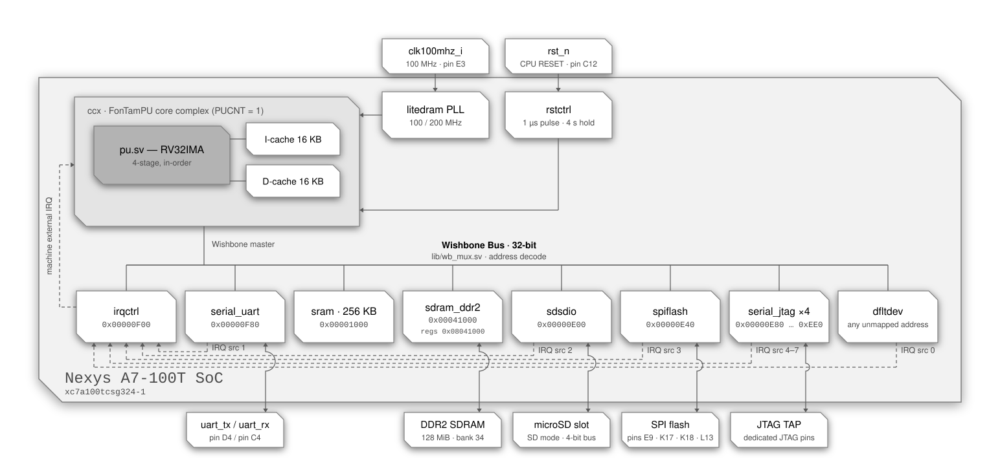

<div align="center">

# RV32 SoC — Nexys A7-100T

**A single-core RISC-V system-on-chip built around the FonTamPU (`ftpu`) core complex,
targeting the Digilent Nexys A7-100T.**


</div>

---

## Contents

- [Overview](#overview)
- [Block diagram](#block-diagram)
- [At a glance](#at-a-glance)
- [Memory map](#memory-map)
- [Device registers](#device-registers)
- [Interrupts](#interrupts)
- [CPU configuration](#cpu-configuration)
- [Clocking](#clocking)
- [Reset behaviour](#reset-behaviour)
- [Pin assignment](#pin-assignment)
- [Building the bitstream](#building-the-bitstream)
- [Loading a program](#loading-a-program)
- [Files](#files)
- [Notes and gotchas](#notes-and-gotchas)

---

## Overview

`nexysa7100.sv` is the top level of a compact RV32 SoC: one `ftpu` hart with private
instruction and data caches, a Wishbone peripheral interconnect, an interrupt
controller, a UART console, an SD host driving the microSD slot in SD mode, a SPI master
on the configuration flash, 256 KB of on-chip SRAM, the 128 MiB DDR2 SDRAM of the board
through a LiteDRAM controller, and a *default device* that acknowledges and reports
every access to an address no other device maps.

The program is baked into the SRAM at synthesis time via `$readmemh`, so the SoC
boots straight into application code at `0x1000`. That program can be
[`apps/bootldr`](apps/bootldr), a bootloader which initializes and calibrates the
DDR2 SDRAM, then loads the application from the SPI flash or the SD card, so that the
application changes without a new bitstream and can use the DDR2 SDRAM.

---

## Block diagram

<p align="center">
  
</p>

<div align="center">
<sub>Solid lines are Wishbone, clock/reset and I/O paths · dashed lines are interrupt paths</sub>
</div>


---

## At a glance

| | |
| :--- | :--- |
| **Board** | Digilent Nexys A7-100T |
| **FPGA** | Xilinx Artix-7 `xc7a100tcsg324-1` |
| **Harts** | 1 (`CPU_COUNT = 1`) |
| **ISA** | RV32IMA + Zicsr, Machine and Supervisor privilege |
| **Pipeline** | 4-stage in-order, single issue, branch / JAL / RET prediction |
| **Core & bus clock** | 100 MHz, from the PLL of the DDR2 controller |
| **Bus** | Wishbone, 32-bit data (`XWORDBITSZ = 32`), single master |
| **Caches** | 16 KB I-cache + 16 KB D-cache, direct-mapped |
| **RAM** | 256 KB on-chip BRAM (`SRAM_KBSIZE = 256`) and 128 MiB of DDR2 SDRAM |
| **DDR2 SDRAM** | Micron MT47H64M16, 128 MiB at `0x00041000`, through LiteDRAM (A7DDRPHY at 200 MHz, DDR2-400); initialized and calibrated by `apps/bootldr` |
| **Console** | UART, 115200 8N1 by default, 2 KB RX + 2 KB TX buffers |
| **SD card** | SD host on the microSD slot, in SD mode on a 4-bit bus: a CMD and a DAT interface, 400 kbps at reset, up to 50 Mbps, 128 B RX + 128 B TX buffers on CMD, 8 KB RX + 8 KB TX on DAT |
| **SPI flash** | SPI master on the configuration flash, a 16 MiB Spansion S25FL128S (or S25FL127S): `cs` high during control words, `miso` sampled on the falling edge, `sclk` through `STARTUPE2`, up to 50 Mbps, 2 KB RX + 2 KB TX buffers |
| **Unmapped access** | Acknowledged by `dfltdev`: reads as `nop`, writes dropped, IRQ source 0 raised, address latched at `0xFFFFFFFC` |
| **Interrupt sources** | 4 — `dfltdev` (0), `serial_uart` (1), `sdsdio` (2), `spiflash` (3) |
| **Reset vector** | `0x00001000` |
| **Initial `sp`** | `0x00041000` (end of the SRAM); bootldr gives its payload the end of the DDR2 SDRAM, `0x08041000`, in `a1` |
| **Toolchain** | Vivado 2020.2 · `riscv32-unknown-elf` GCC |

---

## Memory map

All bases and sizes below are **byte** addresses. The interconnect table in
`nexysa7100.sv` (`WBPI_SDEVS`) stores them as byte values and `lib/wb_mux.sv`
converts them to word indices internally.

| # | Device | Module | Base | Last | Size | Cached |
| :-: | :--- | :--- | :--- | :--- | ---: | :-: |
| 0 | Interrupt controller | `dev/irqctrl.sv` | `0x00000F00` | `0x00000F03` | 4 B (1 word) | no |
| 1 | UART console | `dev/serial_uart.sv` | `0x00000F80` | `0x00000F87` | 8 B (2 words) | no |
| 2 | SRAM | `dev/sram.sv` | `0x00001000` | `0x00040FFF` | 256 KB | yes |
| 3 | DDR2 SDRAM | `rv32-nexysa7100/dev/sdram_ddr2.v` | `0x00041000` | `0x08040FFF` | 128 MiB | yes |
| 4 | DDR2 controller registers | `rv32-nexysa7100/dev/sdram_ddr2.v` | `0x08041000` | `0x08050FFF` | 64 KiB | no |
| 5 | SD card | `dev/sdio.sv` | `0x00000E00` | `0x00000E0F` | 16 B (4 words) | no |
| 6 | SPI flash | `dev/spi.sv` | `0x00000E40` | `0x00000E47` | 8 B (2 words) | no |
| 7 | Default device | `dev/dfltdev.sv` | *every other address* | — | — | no |
| ↳ | Fault address register | `dev/dfltdev.sv` | `0xFFFFFFFC` | `0xFFFFFFFF` | 4 B (1 word) | no |

```
 0x00000000        · · · unmapped → dfltdev · · ·    address 0 included
 0x00000DFF
 0x00000E00 ┌────────────────────────────────────┐
            │   sdsdio · 16 B                    │   0xE00 data · 0xE04 command: CMD
            │                                    │   0xE08 data · 0xE0C command: DAT
 0x00000E0F └────────────────────────────────────┘
 0x00000E10        · · · unmapped → dfltdev · · ·
 0x00000E3F
 0x00000E40 ┌────────────────────────────────────┐
            │   spiflash · 8 B                   │   0xE40 data · 0xE44 command
 0x00000E47 └────────────────────────────────────┘
 0x00000E48        · · · unmapped → dfltdev · · ·
 0x00000EFF
 0x00000F00 ┌────────────────────────────────────┐
            │   irqctrl · 4 B                    │
 0x00000F03 └────────────────────────────────────┘
 0x00000F04        · · · unmapped → dfltdev · · ·
 0x00000F7F
 0x00000F80 ┌────────────────────────────────────┐
            │   serial_uart · 8 B                │   0xF80 data · 0xF84 command
 0x00000F87 └────────────────────────────────────┘
 0x00000F88        · · · unmapped → dfltdev · · ·
 0x00000FFF
 0x00001000 ┌────────────────────────────────────┐   reset vector = 0x00001000
            │                                    │
            │   SRAM · 256 KB · cacheable        │   .text .data .bss
            │                                    │
 0x00040FFF └────────────────────────────────────┘   sp starts at 0x00041000
 0x00041000 ┌────────────────────────────────────┐
            │                                    │
            │   DDR2 SDRAM · 128 MiB · cacheable │   once bootldr initialized it
            │                                    │
 0x08040FFF └────────────────────────────────────┘   a1 from bootldr: 0x08041000
 0x08041000 ┌────────────────────────────────────┐
            │   litedram registers · 64 KiB      │   litedram_init()
 0x08050FFF └────────────────────────────────────┘
 0x08051000        · · · unmapped → dfltdev · · ·
 0xFFFFFFFB
 0xFFFFFFFC ┌────────────────────────────────────┐
            │   dfltdev · fault address · 4 B    │   read OK · write faults
 0xFFFFFFFF └────────────────────────────────────┘
```

### How the decode works

`WBPI_ADDRLIMIT` is `0x1000 + 256 KB + 128 MiB + 64 KiB = 0x8051000`, and the
interconnect sizes its address bus from that: only bits `[27:2]` of the byte address
are carried, with bits `[31:28]` OR-reduced into a single extra "out of range" bit so
**nothing aliases back into a real device** for any access at or above `0x10000000`.

Slave 7 (`dev/dfltdev.sv`) is the catch-all for every address the table does not
claim. It never drives `bsy` and acknowledges every access on the following cycle,
so **an unmapped access always completes**. A read returns the instruction `nop`
(`0x00000013`) and a write is dropped. Both are faults: the address is latched in
the fault address register and interrupt source 0 is raised (see
[Device registers](#default-device--every-unmapped-address)). The only access
to unmapped space that is *not* a fault is a read of the fault address register
itself, at `0xFFFFFFFC`.

Decode is a sequential walk of `WBPI_SDEVS` (`lib/wb_mux.sv`): when an address falls
outside the currently selected device's range, the interconnect — once any
outstanding acknowledgements have drained — restarts at entry 0 and advances one
entry per cycle, holding the bus busy, until it finds the range containing the
address or exhausts the table (which selects the default device). Back-to-back
accesses within one device cost nothing extra; alternating between, say, the UART
and the SRAM re-walks the table at every switch. The DDR2 SDRAM and the registers of
its controller are the entries right after the SRAM; the SD card and the SPI flash,
although mapped below the others, come last, so that adding them left the walk to the
interrupt controller, the UART and the SRAM as short as it was. The default-device
selection is valid only for the address it was walked for: another address presented
in that cycle restarts the walk rather than being handed the default device.

> [!NOTE]
> The core marks everything outside `[0x1000, 0x8041000)`, the SRAM and the DDR2
> SDRAM, as non-cacheable (`cpu_dcache_miss_w`), so device registers — those of the
> DDR2 controller and the fault address register included — are always accessed
> straight through the bus and never sit stale in the D-cache.

> [!NOTE]
> The Verilator simulator (`rv32-sim/`) has no default device: its default slave
> never acknowledges, so the same access ends the simulation with a default-slave
> trap instead of raising an interrupt. Interrupt source 0 is reserved there so
> that source numbering matches the FPGA tops.

---

## Device registers

### Interrupt controller — `0x00000F00`

A single 32-bit register. A **write** submits a command, a subsequent **read**
retrieves its result; two memory operations are always needed.

| Word | Layout |
| :--- | :--- |
| write | `arg[31:2]` · `cmd[1:0]` |
| read | `resp[31:3]` · `rsvd[2]` · `cmd[1:0]` |

| `cmd` | Name | Purpose |
| :-: | :--- | :--- |
| `0b00` | `CMDDEVRDY` | Ready the controller for a new command; clears `resp` |
| `0b01` | `CMDACKIRQ` | Acknowledge an IRQ for destination `arg[31:3]`; `arg[2]` enables/disables further delivery. Returns `-1` if raised by `CMDINTDST` (served first), otherwise the source index, or `-2` if none pending |
| `0b10` | `CMDINTDST` | Raise an interrupt at destination `arg[31:3]` (used for IPIs), held pending for it until it acknowledges it; one raised while one is already pending merges with it, hence the command is never refused. The destination `-1` (all ones) requests a system reset instead |
| `0b11` | `CMDENAIRQ` | Enable (`arg[2] = 1`) or disable a given interrupt source `arg[31:3]` |

The controller has accepted a command only when the `cmd` field read back is
`CMDDEVRDY`; otherwise resend `CMDDEVRDY`. Any non-`CMDDEVRDY` command written while
a transaction is in flight is silently dropped, so use an atomic read-modify-write
to stay thread-safe.

Every source and every destination is **disabled at reset**; no source interrupt is
delivered until software enables the source with `CMDENAIRQ` and the destination with
`CMDACKIRQ` (`arg[2] = 1`). An interrupt raised with `CMDINTDST` bypasses both enables.

A `CMDINTDST` targeting the destination `-1` (`arg[31:3]` all ones) is a **system
reset request**: the controller pulses its `rst_rqst_o` output to the reset
controller, which restarts its reset pulse, so every CPU, cache and device but the
DDR2 controller resets, and the SoC boots again from `0x1000` with its memory contents
intact (see
[Reset behaviour](#reset-behaviour)). The command's result is `-1`, as for any
invalid destination; underLineOS exposes it as `_sysreset()`.

### UART console — `0x00000F80`

| Offset | Address | Register | Description |
| :-: | :--- | :--- | :--- |
| `+0x0` | `0x00000F80` | Data | Read receives one byte, write transmits one byte |
| `+0x4` | `0x00000F84` | Command | Write submits a command, read retrieves the result |

| `cmd` | Name | Purpose |
| :-: | :--- | :--- |
| `0b00` | `CMDDEVRDY` | Make the device accept a new command |
| `0b01` | `CMDGETBUFFERUSAGE` | `arg = 0` → RX bytes used, `arg = 1` → TX bytes used |
| `0b10` | `CMDSETINTERRUPT` | `arg = 0` disables; non-zero enables and sets the RX-usage threshold. Returns the buffer size |
| `0b11` | `CMDSETSPEED` | `arg = PHYCLKFREQ / bitrate`. Returns `PHYCLKFREQ` |

Reset defaults: **115200 baud**, 2048-byte RX and TX buffers (`BUFSZ = 2048`),
**interrupt disabled**. At 100 MHz, `CMDSETSPEED` for 115200 baud takes
`100000000 / 115200 = 868`.

> [!IMPORTANT]
> Reading the data register while the receive buffer is empty holds `wb_bsy_o` — the
> read **blocks** until a byte arrives. That is intentional (it makes `getchar()`
> work), but on a multi-hart build a blocked read holds the bus grant, which is why
> `lib/wb_arbiter.sv` bounds grant duration with `GRANTHELDLIMIT`.

### SD card — `0x00000E00`

`dev/sdio.sv`, instance `sdsdio`, drives the microSD slot of the board in SD mode, on
a bus 4 bits wide. It is made of five lanes, SPI masters in mode 0 sharing the bus
clock: one on the CMD line and one on each of the lines DAT0 – DAT3, the `cs` of a lane
being the inverse of the output enable of its line, which a lane drives only while a
transmission drives it. Its four words make two interfaces, each that of `dev/spi.sv`
— the registers, commands, buffers, control word and transactions which the
[SPI flash](#spi-flash--0x00000e40) section below describes, save the settings
particular to the flash — driven likewise through `hwdrvchar.h`, with
`HWDRVCHAR_DATATYPE` defined to `uintptr_t`:

| Offset | Address | Register | Description |
| :-: | :--- | :--- | :--- |
| `+0x0` | `0x00000E00` | CMD data | Write transmits one word on CMD, byte 0 first, each most significant bit first; read receives one |
| `+0x4` | `0x00000E04` | CMD command | Write submits a command to the CMD interface, read retrieves the result |
| `+0x8` | `0x00000E08` | DAT data | Write transmits one word on DAT0 – DAT3, a nibble per clock: byte 0 first, each byte as its high nibble then its low nibble, the bits `4+i` and `i` of each byte on DATi; read receives one |
| `+0xC` | `0x00000E0C` | DAT command | Write submits a command to the DAT interface, read retrieves the result |

Hence the bytes of a command, and of a data block with its four CRC16, go out, and
those of a response or of a data block come in, in the order of their addresses. The
commands are those of `dev/spi.sv`, with these differences:

| `cmd` | Name | Difference |
| :-: | :--- | :--- |
| `0b01` | `CMDGETBUFFERUSAGE` | On the DAT interface, the usages are those of the lane which received the fewest words and of the lane which transmitted the fewest |
| `0b10` | `CMDSETINTERRUPT` | Returns the buffer size of the interface: 128 bytes (32 words) on CMD, 8192 bytes (2048 words) on DAT |
| `0b11` | `CMDSETSPEED` | Sets the bitrate of the bus, one for both interfaces: change it while both TX usages are `0`. 400 kbps at reset, the highest at which a card may be initialized; up to 50 Mbps |

The lanes are kept in lockstep: the bus clock toggles while a lane of either interface
is in a transmission, every lane in one transferring its next bit at each clock, and
while a lane pauses — its TX buffer empty, or waiting for room in its RX buffer — the
clock stops low and every lane is frozen until it resumes. The card allows its clock to
stop at any time, save that it needs 8 clocks after the end of a transaction before a
long stop, and that the `ACMD41` which initialize it are to be less than 50 ms apart when
its clock stops between them; hence a transmission may pause, preemption included.

The control word keeps the bits of `dev/spi.sv`, plus bit 4: when `0`, the transmission
is **chained** to the next one of the same interface, the clock staying stopped from its
end until that one begins, so that a response which the card begins a few clocks after a
command is not clocked before the transmission which receives it. On the CMD interface
those bits are bits 0 – 4 of the control word: `0xFFFFFFEF` begins a chained transmission
driving CMD, `0xFFFFFFFB` one keeping CMD released, to receive, and `0xFFFFFFFA` one
waiting for the start bit of a response. On the DAT interface each lane `i` takes its
control bits from the bits `4+i` and `i` of the bytes 0 – 3: `0xFFFFF0FF` begins a
chained transmission driving every DAT line, `0xFFF0FFFF` one keeping them released, and
`0x0000FFFF` one waiting on each line for the start bit of a data block, discarding it,
with receive flow control, so that the block lands word aligned. The recipes — a command
and its response, a block read, a block written with its CRC status and busy — are in the
header of `dev/sdio.sv`; the driver `hwdrvsdsdio.h` (in `ftpu/sw`) follows them: it
initializes the card at 400 kbps, switches it to its high speed mode when it supports it,
then sets the highest bitrate the card supports, up to 50 Mbps.

Waiting for the start bit of a response is given up after **2 ms** on CMD, that of a data
block after **250 ms** on DAT, and a pause, or the wait for the transmission which follows
a chained one, after **100 ms**: the transmission is then aborted as on `dev/spi.sv`, the
words written discarded until its close. Reads and writes of a data word block as those
of `dev/spi.sv` do — on the DAT interface, while the RX buffer of any lane is empty, or
the TX buffer of any lane full.

The device raises **one** interrupt request, source 2, when its interrupt is enabled on
either interface and the RX usage of that interface reaches its threshold, and only while
both interfaces are ready for a command. Acknowledging the interrupt disables it on both
interfaces, and a close disables it on its own interface, so re-enable it after the close
if it is used; to silence it without closing, set a threshold above the buffer, 129 on
CMD or 8193 on DAT.

The slot is powered while `sd_reset` is low, where the top holds it. The auxiliary
microcontroller of the board, which shares the bus of the card with the FPGA and uses it
before the FPGA is configured, power-cycles the slot once a bitstream is loaded, from any
source, then hands the bus over: loading a bitstream thus returns a card left in SPI mode
to SD mode, whereas a reset of the design does not power-cycle it. The card-detect switch
of the slot is not used.

[`apps/sdcardtest`](apps/sdcardtest) benchmarks the card: it reads the 32 MiB which follow
the first 32 MiB of the card, 128 blocks per call of the driver, then reads each chunk
again and writes it back with its own content, timing the reads, then the writes only,
so that the card is left as it was, barring a power loss during the writes; untimed
passes before and after compare the CRC32 of the blocks. Its `SDCARDTEST_*` defines,
described in the header of `sdcardtest.c`, set the region, the chunk size, the bitrate,
polling, the CRC checks, and SPI mode through `hwdrvsdspi.h`, which is for a top with a
SPI master on its slot.

### SPI flash — `0x00000E40`

`dev/spi.sv`, instance `spiflash`, is a SPI master in mode 0 (`CPOL = 0`, `CPHA = 0`) on
the configuration flash of the board, a Spansion S25FL128S of 16 MiB (or, on some
boards, the S25FL127S, which shares the commands used), which it drives through
single-bit commands. It transfers a 32-bit word at a time, most significant bit of
least significant byte first: a buffer in memory goes out, and comes in, in address
order. Its registers and commands are those of the UART console, so the
character-device driver `hwdrvchar.h` drives it, every count in bytes, with
`HWDRVCHAR_DATATYPE` defined to `uintptr_t` before including it, so that
`hwdrvchar_read()` and `hwdrvchar_write()` access the data register a word at a time:

| Offset | Address | Register | Description |
| :-: | :--- | :--- | :--- |
| `+0x0` | `0x00000E40` | Data | Write transmits one word, byte 0 first; read receives one, the first byte received in byte 0. `wb_sel_i` is ignored: a byte or halfword access still moves a whole word |
| `+0x4` | `0x00000E44` | Command | Write submits a command, read retrieves the result |

| `cmd` | Name | Purpose |
| :-: | :--- | :--- |
| `0b00` | `CMDDEVRDY` | Make the device accept a new command |
| `0b01` | `CMDGETBUFFERUSAGE` | `arg = 0` → RX bytes used, `arg = 1` → TX bytes not yet transmitted, counting a paused transmission and a pending close, capped to the buffer size, `0` only when no transmission is in progress; both are multiples of 4 |
| `0b10` | `CMDSETINTERRUPT` | `arg = 0` disables, and **closes** the transmission in progress; non-zero enables and sets the RX-usage threshold in bytes, a threshold between two multiples of 4 being reached at the greater one. Returns the buffer size in bytes |
| `0b11` | `CMDSETSPEED` | `arg = PHYCLKFREQ / bitrate`; sets the highest bitrate `100 MHz / 2n` not above `100 MHz / arg`, from 50 Mbps down to about 100 kbps, `arg = 0` selecting the lowest. Returns `PHYCLKFREQ` |

Reset defaults: **400 kbps**, 2048-byte (512-word) RX and TX buffers (`BUFSZ = 512`),
**interrupt disabled**. At 100 MHz, `CMDSETSPEED` for 25 Mbps takes
`100000000 / 25000000 = 4`.

Transfers are full duplex: while a word written is transmitted on `mosi`, a word is
received from `miso` into the RX buffer. The word written while the TX usage is `0`
begins a **transmission**, which lasts, `cs` low, until it is **closed** with
`CMDSETINTERRUPT` and a null `arg`: it then ends once every word written before that
command has been transmitted. When the TX buffer runs empty before, the transmission
**pauses** — `sclk` idle, `cs` kept, nothing clocked — until the next word written
resumes it, so the words can be written at any pace, preemption included. A close
while no transmission is in progress does nothing, hence the `CMDSETINTERRUPT` which
ends `hwdrvchar_init()` is harmless. The first word of a transmission is a **control
word**: 32 ones are transmitted in its place, the word received meanwhile is kept as
any other, and bits 0 – 3, the low half of its first byte in transmission order,
configure the transmission:

| Bit | When `0` |
| :-: | :--- |
| 0 | Before counting the bits transmitted, wait for a `0` bit on `miso`, `sclk` toggling meanwhile with `mosi` high — ie: the start bit of an SD card's response or data token |
| 1 | Discard that `0` bit, so that the word received in place of the control word is the 32 bits after it, otherwise that `0` bit is its bit 7; ignored unless bit 0 is `0` |
| 2 | Keep `cs` **high** for the whole transmission — ie: `0xFFFFFFFB` followed by two `0xFFFFFFFF`, then the close, sends 96 clock cycles with `cs` and `mosi` high, covering the 74 at least which an SD card needs before its first command |
| 3 | **Receive flow control**: while the RX buffer holds 2044 bytes (511 words) or more, pause instead of taking the next word, so that nothing received is dropped; the control word itself waits for room. The RX usage then stops at 2044, or at 2048 when the next word was already waiting, so use an interrupt threshold of at most 2044 |
| 4 – 31 | Reserved; write `1` |

Hence `0xFFFFFFFF` begins a plain transmission, `0xFFFFFFF7` one with flow control,
and `0xFFFFFFFB` one with `cs` high; a byte store to `0x00000E40` which begins a
transmission makes a control word whose byte 0 is that byte. A transaction goes as
follows:

```c
#define HWDRVCHAR_DATATYPE uintptr_t           // a word per access of the data register
#include "hwdrvchar.h"
uintptr_t junk[16], c;
// Prologue: end whatever is left open, drop stale responses, wait until idle.
hwdrvchar_interrupt(dev, 0);
do hwdrvchar_read(dev, junk, sizeof(junk)); while (hwdrvchar_writable(dev) != dev->bufsz);
while (hwdrvchar_read(dev, junk, sizeof(junk)));
c = 0xffffffff;                                // plain; 0xfffffff7 = receive flow control
hwdrvchar_write(dev, &c, sizeof(c));
/* hwdrvchar_write()/hwdrvchar_read() at any pace, preemptible; read every expected response,
   e.g. a flash READ: the command and its address, then a filler word per word to read */
hwdrvchar_interrupt(dev, 0);                   // close (re-arm the interrupt afterwards if used)
while (hwdrvchar_writable(dev) != dev->bufsz); // ended
```

Waiting for the `0` bit is given up after **100 ms**, and so is a pause, whether it
waits for a word to be written or for room in the RX buffer, as is a control word
waiting for room: the transmission is aborted with `cs` high, and no interrupt is
raised. The words still buffered, and every word written afterwards, are then
**discarded until the close**, so that a writer resuming after the abort never has a
data word taken for a control word; the words received before remain. Software sees
the TX usage return to `0` before its close, which never happens while a
transmission is in progress. A transmission left open thus ends by itself:
`hwdrvchar_init()` alone returns the device to idle, its final command ending the
discard.

> [!IMPORTANT]
> Close every transaction, and begin it with the prologue above: a transaction begun
> within 100 ms of another left open goes out as that one's data, control word
> included. The next transaction cannot be queued behind a close: wait for the TX
> usage to reach `0`. Without flow control, every word written yields a word received
> and the RX buffer drops what arrives while it is full, so keep the bytes written
> less the bytes read within 2048. `CMDSETINTERRUPT 0` within a transaction ends it;
> to silence the interrupt without closing, set a threshold of 2049, never reached.
> Under flow control, write no more than `hwdrvchar_writable()` allows, as
> `hwdrvchar_write()` does: a write stalled on a full TX buffer while the transmission
> waits for the reader holds the bus until the 100 ms timeout. Reads and writes of the
> data register block as the UART console's do. With a `HWDRVCHAR_DATATYPE` of a byte,
> each access would move a whole word, and the reads beyond the words received would
> wait for a word which, once nothing written remains to be received, never comes.

This instance is set up for the flash rather than for the plain mode 0 device above:

| | |
| :--- | :--- |
| `CTRLCSHIGH = 1` | `cs` is **high** while the 32 ones are transmitted in place of the control word, and falls one clock cycle after their last falling edge of `sclk`, a full half-period before the next rising edge: the flash, which takes the first byte after the fall of its chip select for an instruction, is sent nothing before the command |
| Byte 1 of the control word | The count of bytes, after the control word, during which `cs` is low: `cs` rises on the falling edge of `sclk` which ends the last of them, and stays high to the end, `sclk` and `mosi` going on; `0xFF`, the reserved value, keeps it low until the end, `0x00` never lets it fall. Hence `0xFFFF01FF` followed by `0xFFFFFF06` sends WRITE ENABLE alone, `cs` rising right after its eighth bit, as the flash requires, the other three bytes being clocked with `cs` high |
| `LATESAMPLE = 1` | `miso` is sampled on the falling edge of `sclk` which ends each bit, instead of the rising edge which begins it: the flash changes its output on the falling edge, and at 50 Mbps the output delay of the pad, the clock-to-output of the flash and the input delay exceed the 10 ns of half a period, but typically not the 20 ns of a full one. It is not for an SD card in high speed mode, which changes its output on the rising edge |
| Clock | `sclk` reaches the flash as the configuration clock `CCLK` (pin `E9`), a dedicated pin which no xdc places, through the `STARTUPE2` primitive; its first three cycles after configuration are not output (AMD answer record 52626), which the cycles of the first control word, `cs` high, absorb |
| Control bit 0 | Must remain `1`: the wait for a `0` bit would happen with `cs` high, on a flash not selected, until the 100 ms timeout, and the bit would be sampled on the wrong edge |

The driver `hwdrvspiflash.h` (in `ftpu/sw`) reads with READ (`03h`), writes with
PAGE PROGRAM (`02h`), each page preceded by WRITE ENABLE (`06h`), and checks the
status register with READ STATUS REGISTER (`05h`), sending WRITE DISABLE (`04h`)
where a write is refused; it never erases. A page program only clears bits, so a
write leaves null the bits which were null: write locations erased by other means,
or data clearing bits only — writing back the data read leaves the flash unchanged,
which `apps/spiflashtest` does, benchmarking the 4 MiB which follow the bitstream
and checking them with CRC32s. On the S25FL, programming a 16-byte unit a second
time disables its Automatic ECC until the unit is erased.

> [!WARNING]
> The bitstream occupies the beginning of the flash, about 3.65 MiB uncompressed
> and less with the compression this project enables: a write there corrupts the
> configuration, which then fails at the next power-up.

### DDR2 SDRAM — `0x00041000`

`rv32-nexysa7100/dev/sdram_ddr2.v` maps the DDR2 SDRAM of the board, a Micron
MT47H64M16 of 128 MiB, at `0x00041000` – `0x08040FFF`, and the registers of its
controller at `0x08041000` – `0x08050FFF`. The controller is LiteDRAM, which LiteX
generated in `litedram/litedram.v` from LiteDRAM's `examples/nexys4ddr.yml` (its header
holds that configuration): its A7DDRPHY runs the DDR2 SDRAM at 200 MHz (DDR2-400,
CL 3), and its native user port, 64 bits wide, takes up to 8 accesses at a time from
the 32-bit bus through `lib/wb_upsizr.sv` and `lib/wb_litedram.sv`, its registers
through `lib/wb_classic.sv`. The D-cache of the core caches the DDR2 SDRAM as it does
the SRAM; `sdram_ddr2.v` can put a data cache of 32 KiB of its own in front of the
controller (`USECACHE`), which the top leaves out.

The DDR2 SDRAM must be initialized and calibrated before it is used:
`litedram_init()` of `litedram/litedram.c`, which `apps/bootldr` calls before it loads
the application, does so through those registers, printing its read leveling, and
fails when it finds no read window, which stops bootldr. An access made before is
not held: the controller completes it on the DDR2 SDRAM uninitialized. The reset of the
system (`CPU RESET`, `_sysreset()`) does not reset the controller, so that the DDR2
SDRAM keeps its content across it, not across a configuration of the FPGA. A loss of
the lock of the PLL of the controller resets the controller, the system and the bitslips
of its PHY, which nothing calibrates again: the next accesses complete on the DDR2
SDRAM uncalibrated.

### Default device — every unmapped address

`dev/dfltdev.sv` owns every address the table does not claim. It has one register,
the **fault address register**, read from the last word of the address space:

| Address | Access | Behaviour |
| :--- | :-: | :--- |
| `0xFFFFFFFC` | read | Returns the address of the **first** fault since the register was last read. Not a fault. |
| any other unmapped address | read | Returns `0x00000013` (`nop`); **fault** |
| any unmapped address, `0xFFFFFFFC` included | write | Dropped; **fault** |

A fault raises interrupt source 0 and, if no earlier fault is still waiting to be
read, latches its address. The request is held until it is acknowledged through
`irqctrl` (`CMDACKIRQ`); faults meanwhile keep it raised but are not reported
separately, save one landing in the very cycle of the acknowledgement, which raises
a fresh request. The register can also simply be polled — the address is latched
whether or not source 0 is enabled.

The value read is the address **as seen on the bus**, sign-extended: bits `[27:2]`
are exact, bit `28` is the OR of bits `[31:28]` of the faulting address and is
replicated into bits `[31:29]`, and bits `[1:0]` always read zero (the bus carries
word addresses, so the byte offset of the access is lost). Hence:

| Faulting address | Reads back as |
| :--- | :--- |
| below `0x10000000` (fits the address bus) | exactly |
| `0xF0000000` – `0xFFFFFFFF` (a small negative pointer) | exactly |
| anything else | a negative value whose bits `[27:2]` are the faulting address's — the exact address is not recoverable |

Two details worth knowing:

- The register is **not cleared** by the read: it keeps the last latched address
  (`0` after reset) until the next fault overwrites it.
- Because only bits `[27:2]` and the OR bit travel on the bus, `0xFFFFFFFC` is the
  canonical address of the register but not the only one that reaches it: any
  address whose bits `[27:2]` are all ones and whose bits `[31:28]` are not all zero
  does. Use `(uintptr_t)-4`.

---

## Interrupts

The SoC instantiates `IRQSRCCOUNT = 4` sources and `IRQDSTCOUNT = CPU_COUNT = 1`
destination.

### Sources

| Index | Source | Constant | Raised when |
| :-: | :--- | :--- | :--- |
| 0 | `dfltdev` | `IRQ_DFLTDEV` | Any access to an unmapped address, other than a read of the fault address register |
| 1 | `serial_uart` | `IRQ_SERIAL` | RX buffer usage reaches the threshold set by `CMDSETINTERRUPT` |
| 2 | `sdsdio` | `IRQ_SDSDIO` | RX buffer usage of either interface reaches the threshold set by its `CMDSETINTERRUPT`, while both interfaces are ready for a command |
| 3 | `spiflash` | `IRQ_SPIFLASH` | RX buffer usage reaches the threshold set by `CMDSETINTERRUPT` |

Source 0 is reserved for the default device by convention on every top in the
repository, including `rv32-sim/` where it never fires.

### Destinations

| Index | Destination |
| :-: | :--- |
| 0 | hart 0 |

### Delivery

`irqctrl` dispatches to destinations round-robin, preferring any whose
`irq_dst_pri_i` is high (driven by each hart's `halted_o`, so halted harts are
favoured); the lowest index wins ties. At the core, a dispatched interrupt arrives
as a **machine external interrupt (MEI)**, or as **SEI** when the corresponding
`MIDELEG` bit is set.

| Mechanism | Where it lives |
| :--- | :--- |
| External interrupt (MEI / SEI) | `dev/irqctrl.sv`, memory-mapped at `0x00000F00` |
| Timer interrupt (MTI / STI) | CSRs `mtimecmp` `0x34D` and `mtimecmph` `0x35D` for MTI, or, while `MIDELEG` delegates the timer interrupt, `stimecmp` `0x14D` and `stimecmph` `0x15D` for STI — **not** memory-mapped |
| Software interrupt (MSIP / SSIP) | **not implemented**; use `CMDINTDST` for IPIs |

> [!NOTE]
> There is no CLINT and no PLIC. The timer compare registers are ordinary CSRs, and
> `time`/`cycle` are read from the same counter. Vectored interrupts are not
> supported. Simultaneous interrupts are taken in the order MEI, SEI, MTI, STI.

Three behaviours worth coding around:

- **Acknowledge promptly.** `irqctrl` dispatches source interrupts one at a time for
  all destinations; until the current one is acknowledged with `CMDACKIRQ` it cannot
  dispatch another. Interrupts raised with `CMDINTDST` are held per destination instead.
- **The UART, SD card and SPI flash interrupts disarm themselves.** Each is disabled at
  reset (so no spurious interrupt can fire immediately after release) and disabled
  again each time a raised interrupt is acknowledged, so the handler must re-enable it.
  On the SPI flash, `CMDSETINTERRUPT 0` also closes the transmission in progress:
  disable the interrupt within a transaction with a threshold of 2049 instead. On the
  SD card, an acknowledgement disables the interrupt on both interfaces, and a close on
  its own; silence it within a transaction with a threshold of 129 on CMD or 8193 on
  DAT.
- **The fault interrupt is imprecise.** It arrives as an ordinary external
  interrupt, several instructions after the access that caused it, and that access
  has already completed — a load has consumed the word `0x00000013`, a store has
  been dropped, a fetch has executed a `nop`. The core has no
  instruction-access-fault, so a *speculative* instruction fetch of an unmapped
  address — a wrong-path fetch launched before the redirect that cancels it — also
  reaches `dfltdev` and reports a fault that never happened architecturally. Read
  the fault address register in the handler to find out what was touched.

---

## CPU configuration

Selected in the header of `nexysa7100.sv`:

| Feature | Setting | Effect |
| :--- | :-: | :--- |
| `PURV32M` | on | `M` extension — `mul` / `div` / `rem` |
| `PUIMULDSP` | on | Multiplies in DSP48 slices instead of iterative radix-4 shift-add |
| `PUIDIVDSP` | off | Divide uses the default radix-4 digit-recurrence |
| `PUPREDICTJAL` | on | JAL prediction |
| `PUPREDICTBRANCH` | on | Branch prediction, BHT 4096 entries |
| `PUPREDICTRET` | on | Return prediction, RAS 8 entries |
| `PUEARLYREDIRECTFETCH` | off | Carried commented out — would fetch a mispredicted branch target one cycle earlier (one lost slot instead of two) |
| `PUICACHEFILLBYPASS` | off | Carried commented out — would hand the fetch stage the refilled word directly (an I-cache miss costs three slots instead of four) |
| `PUDCACHEREGRQST` | on | Registers the D-cache request path (+1 cycle, better timing) |
| `PUDCACHEREGRESP` | on | Registers the D-cache response path (+1 cycle, better timing) |
| `PUAMOREGWB` | off | AMO write-back computed from the live D-cache response |
| `PURV32ZBA/ZBB/ZBC/ZBS` | off | Bit-manipulation extensions disabled |
| `PURV32ZFINX` | off | No FPU — software floating point |
| `PUFDIVDSP2` / `PUFSQRTDSP2` | on | Pre-selects correctly-rounded DSP Newton-Raphson `fdiv` / `fsqrt` for a Zfinx build; inert while `PURV32ZFINX` is off |

Atomics (`lr` / `sc` / `amo*`) are always present, so the effective ISA string is
**RV32IMA**. Caches are `ICACHESZ = DCACHESZ = 16` KB with `ICACHEWAYCNT =
DCACHEWAYCNT = 1` (direct-mapped). `IMULCNT` is left at the `ccx` default of 1:
the pipelined multiplier accepts a new multiply while results queue for
write-back, so a second instance would buy no cycles.

The core is reset with `rstaddr_i = rstaddr2_i = 0x1000` and `spval_i = 0x41000`, so
execution starts at the bottom of the SRAM with the stack pointer at the top of it,
the DDR2 SDRAM being uninitialized at reset.

---

## Clocking

The PLL of the DDR2 controller turns the 100 MHz board oscillator into the 100 MHz
clock of the controller, the 200 MHz reference of its input delays, and the 200 MHz
clocks of its PHY. Its 100 MHz is the clock of the whole SoC — CPU, interconnect,
UART, SD card and SPI flash PHYs — which runs in that single **100 MHz** domain, so
there is no clock-domain crossing (`USEMEMCLKDOM` evaluates to 0 for a single hart with
a D-cache).

> [!NOTE]
> `lib/xc7pll_100_to_50_100_200.sv` is still instantiated, but none of its outputs is
> used, hence implementation removes it; it is there for peripherals that need its 50,
> 100 or 200 MHz.

---

## Reset behaviour

`lib/rstctrl.sv` is instantiated with `RSTDURATION = 100` cycles (1 µs) and
`RSTTHRESH = 400000000` cycles (**4 s**) off `rst_n` (the `CPU RESET` button, pin
`C12`). Its behaviour is deliberate and surprising the first time:

| Event | Result |
| :--- | :--- |
| Power-on / after configuration | SoC is **held in reset** — it does not start on its own |
| First press of `CPU RESET` | Releases reset after a 1 µs pulse; the SoC begins executing |
| Short press afterwards | **Ignored** |
| Press held ≥ 4 s | Asserts a fresh 1 µs reset pulse |
| Software request (`_sysreset()`, ie: `CMDINTDST` with the destination `-1`) | Asserts a fresh 1 µs reset pulse at once, no button hold needed |

The reset of the SoC also lasts until the PLL of the DDR2 controller is locked. The
DDR2 controller is not reset by the reset of the SoC, so that the DDR2 SDRAM keeps its
content across a press of `CPU RESET` and `_sysreset()`; it is reset only at the
configuration of the FPGA, or when its PLL loses its lock, which leaves the DDR2 SDRAM
uncalibrated. Nor does the reset of the SoC power-cycle the SD card, which only a
configuration of the FPGA does.

> [!TIP]
> If the board appears dead after programming, press `CPU RESET` once — that is the
> intended way to start it. To reset a running system, hold `CPU RESET` for four
> seconds, or have the program request it with `_sysreset()`.

---

## Pin assignment

From `nexysa7100.xdc`:

| Signal | Pin | Standard | Board net |
| :--- | :-: | :--- | :--- |
| `clk100mhz_i` | `E3` | LVCMOS33 | `clk100mhz`, 100 MHz oscillator |
| `rst_n` | `C12` | LVCMOS33 | `cpu_resetn` (CPU RESET button) |
| `uart_rx` | `C4` | LVCMOS33 | `uart_txd_in` (from the USB-UART bridge) |
| `uart_tx` | `D4` | LVCMOS33 | `uart_rxd_out` (to the USB-UART bridge) |
| `sdsdio_clk_o` | `B1` | LVCMOS33, fast slew | `sd_sck` (microSD slot) |
| `sdsdio_cmd_io` | `C1` | LVCMOS33, pull-up | `sd_cmd` |
| `sdsdio_dat_io[0]` … `sdsdio_dat_io[3]` | `C2` `E1` `F1` `D2` | LVCMOS33, pull-up | `sd_dat[0]` … `sd_dat[3]` |
| `sd_reset_o` | `E2` | LVCMOS33, driven low | `sd_reset` (the slot is powered while it is low) |
| `an[0]` … `an[7]` | `J17` `J18` `T9` `J14` `P14` `T14` `K2` `U13` | LVCMOS33, driven high | `an[0]` … `an[7]`, anodes of the seven-segment display, active low — it stays dark |
| `spiflash_cs_o` | `L13` | LVCMOS33 | `qspi_csn` (configuration flash) |
| `spiflash_mosi_o` | `K17` | LVCMOS33 | `qspi_dq[0]` |
| `spiflash_miso_i` | `K18` | LVCMOS33, pull-up | `qspi_dq[1]` |
| `spiflash_wp_o` | `L14` | LVCMOS33, driven high | `qspi_dq[2]` (`W#`) |
| `spiflash_hold_o` | `M14` | LVCMOS33, driven high | `qspi_dq[3]` (`HOLD#`) |

The registers driving the clock, the CMD and the DAT lines of the SD card, and those
sampling them, are packed in the I/O tiles (`IOB TRUE`): a bit sent by the card is
sampled in the clock cycle where the device raises the clock, before the card sees that
edge, hence the delays of the pads shorten the time left to the card to answer. The
board pulls CMD and DAT up to the supply of the slot through 100K resistors; they are
pulled up in the FPGA as well, so that they are high while neither side drives them.
The clock switches with a fast slew rate, as the high speed mode of the card requires
edges of 3 ns at most.

The clock of the flash is the configuration clock `CCLK`, which `STARTUPE2` drives,
hence no pin in the xdc; the registers driving `spiflash_cs_o` and
`spiflash_mosi_o`, and the one sampling `spiflash_miso_i`, are packed in the I/O
tiles (`IOB TRUE`). `W#` and `HOLD#` are held high, as single-bit commands use
neither.

The 46 pins of the DDR2 SDRAM, `ddr2_*`, all in bank 34 at 1.8 V, are those of the
`digilent_nexys4ddr.py` platform of litex-boards: `SSTL18_II`, `DIFF_SSTL18_II` for the
strobes `ddr2_dqs_p/n` and the clock `ddr2_ck_p/n`, `SLEW FAST`, an
`IN_TERM UNTUNED_SPLIT_50` termination on the data, and the internal VREF of the bank at
0.9 V. The xdc also constrains the reset synchronizers of the DDR2 controller as LiteX
does.

Bitstream settings: compression enabled, `CONFIGRATE 33`, `CONFIG_MODE SPIx4`,
`CFGBVS VCCO` at 3.3 V.

---

## Building the bitstream

Requires **Vivado 2020.2** (the project file declares that version; newer Vivado will
offer to upgrade it).

```sh
cd rv32-nexysa7100/vivado
vivado nexysa7100.xpr
```

Then run synthesis, implementation and *Generate Bitstream*, and program the board
from the Hardware Manager.

The project's top module is `nexysa7100`, sourced directly from `../nexysa7100.sv`,
with the Verilog include directories set to the repository root and `cpu/` — that
is how the `` `include "lib/..." `` and `` `include "cpu/..." `` directives in
`nexysa7100.sv` resolve. If you build outside this project, reproduce both include
paths.

Three things the project does beyond the defaults:

- **A latch fails the build.** A project message rule raises `Synth 8-327`
  (*inferring latch*) from warning to error, so a synthesis run that infers a latch
  stops at `synth_design` instead of quietly completing.
- **A constraint that matches nothing fails the build.** A second rule raises
  `Common 17-55` from critical warning to error. Vivado reports it when a
  `set_property` is handed an empty object list — what a `get_ports` or `get_cells`
  pattern matching nothing returns — so a mistyped or stale name in `nexysa7100.xdc`
  is caught when it is written instead of silently constraining nothing.
- **Twenty-one implementation runs.** `impl_1` builds on the default strategy;
  `impl_2` … `impl_21` each apply one of Vivado's *Performance_\** / *Congestion_\**
  strategies off the same `synth_1`. Launching them all is how timing closure at
  100 MHz is swept. The margin is thin, and which strategies meet it changes with
  every change of the design, so take the bitstream from a run whose timing summary
  shows it met.

Open a console on the board's USB-UART bridge at **115200 8N1**:

```sh
picocom -q --imap lfcrlf -b 115200 /dev/ttyUSB1     # or screen, minicom, ...
```

---

## Loading a program

SRAM contents come from `$readmemh` at elaboration time, so on this top as committed —
one console, no gdb channel — **changing the program baked in means re-running
synthesis and implementation**, unless that program is the bootloader
[`apps/bootldr`](#from-the-spi-flash-or-the-sd-card-appsbootldr), which loads the
application from the SPI flash or the SD card. The `examples/rv32-nexysa7100/serial_jtag`
branch demonstrates four serial consoles tunneled over JTAG, which can carry underLineOS's
gdb stub, the first one, at `0xE80`, being its default device, so that a running image
linked with the stub can be replaced from gdb without a new bitstream; the underLineOS
documentation (GDB stub, *Loading a new program*) describes the procedure.

The build knobs are `` `ifndef ``-guarded defaults at the top of `nexysa7100.sv`, so
they can be overridden from the Vivado *Verilog options* (`verilog_define`) without
editing the file:

```systemverilog
`ifndef CPU_COUNT
`define CPU_COUNT 1
`endif
`ifndef XWORDBITSZ
`define XWORDBITSZ 32
`endif
`ifndef SRAM_KBSIZE
`define SRAM_KBSIZE 256
`endif
`ifndef SRAM_INITFILE
`define SRAM_INITFILE "../../../../rv32-sim/apps/coremark/rv32/coremark.32.hex"
`endif
```

`SRAM_INITFILE` is resolved by `$readmemh` relative to the synthesis run directory
(`vivado/nexysa7100.runs/synth_1/`), which is why the default climbs four levels
to reach the repository root.

The default image is CoreMark. Any application under [`rv32-sim/apps/`](../rv32-sim/apps)
— `helloworld`, `donut`, `tinyraytracer`, … — can be dropped in by
pointing `SRAM_INITFILE` at its `*.32.hex`, as can [`apps/spiflashtest`](apps/spiflashtest),
the benchmark of the SPI flash, with `../../../apps/spiflashtest/spiflashtest.32.hex`,
and [`apps/sdcardtest`](apps/sdcardtest), the benchmark of the SD card, with
`../../../apps/sdcardtest/sdcardtest.32.hex`.

To build your own, link at `0x1000` and emit a whitespace-separated list of 32-bit
words:

```sh
riscv32-unknown-elf-gcc -O3 -Wl,-z,max-page-size=4 -o app.elf app.c
riscv32-unknown-elf-objcopy -O binary app.elf app.bin
truncate --size=%4 app.bin
hexdump -v -e '/4 "%08x "' app.bin > app.32.hex
```

The `.32.hex` suffix matters: the same makefiles also emit 64/128/256-bit variants
for wider `XWORDBITSZ` builds, and this target uses a 32-bit bus.

> [!NOTE]
> `SRAM_KBSIZE` must stay a power of two, and 256 is the most this device holds.
> Changing it moves the end of RAM, and with it `WBPI_ADDRLIMIT`, the initial stack
> pointer and the cacheable window — all of which are derived from it automatically.
> Widening `WBPI_ADDRLIMIT` also widens the address bus, and with it the window of
> addresses the fault address register reports exactly. It also moves the DDR2 SDRAM
> and the registers of its controller, which follow the SRAM, but not their address in
> `litedram/litedram.c`: build `apps/bootldr` with `-DLITEDRAM_BASE=` the new end of the
> SRAM, its default being `0x41000`, ie:
> `make clean && CFLAGS=-DLITEDRAM_BASE=0x21000 make` for 128 KB.

### From the SPI flash or the SD card: `apps/bootldr`

[`apps/bootldr`](apps/bootldr) is a bootloader baked into the SRAM in place of the
application. Started by the first press of `CPU RESET`, it initializes and calibrates the
DDR2 SDRAM, then reads the data at byte `0x400000` of the SPI flash, right past the
4 MiB kept for the bitstream, into the DDR2 SDRAM, checks the CRC32 of the payload it
holds, copies the payload to `0x1000`, and starts it with the system reset that
`_sysreset()` also requests: the CPU, its caches and the devices restart, but the SRAM
and the DDR2 SDRAM keep their content. The payload gets the end of the DDR2 SDRAM,
`0x08041000`, in register `a1`, which underLineOS's `crt0.S` takes for its end of
memory. Here, on the board, with [`rv32-sim/apps/memtest`](../rv32-sim/apps/memtest)
as the payload, which then tests the memory from its heap to its stack:

```
🚀 Starting bootloader ...
Initializing SDRAM @ 0x41000...
Switching SDRAM to software control.
Read leveling:
  m0, b00: |00000000000000000000000000000000| delays: -
  m0, b01: |00000000000000000000000000000000| delays: -
  m0, b02: |10000000000000000000000000000000| delays: -
  m0, b03: |00011111111111111111111111111111| delays: 17+-14
  m0, b04: |00000000000000000000000000000000| delays: -
  m0, b05: |00000000000000000000000000000000| delays: -
  m0, b06: |00000000000000000000000000000000| delays: -
  m0, b07: |00000000000000000000000000000000| delays: -
  best: m0, b03 delays: 17+-14
  m1, b00: |00000000000000000000000000000000| delays: -
  m1, b01: |00000000000000000000000000000000| delays: -
  m1, b02: |10000000000000000000000000000000| delays: -
  m1, b03: |00011111111111111111111111111111| delays: 16+-14
  m1, b04: |00000000000000000000000000000000| delays: -
  m1, b05: |00000000000000000000000000000000| delays: -
  m1, b06: |00000000000000000000000000000000| delays: -
  m1, b07: |00000000000000000000000000000000| delays: -
  best: m1, b03 delays: 16+-14
Switching SDRAM to hardware control.
💾 SPI flash at 0xe40 | 📦 4194304 words (16.0MB) | ⚡ 50000000 bps
📍 word 1048576 (4.0MB)
📥 Loaded: 18240 B (17.8KB) | ⏱️ 0.002928 s | 📊 5.9MB/s | 🔢 CRC32 0x1cb6430c ✅
🔄 Resetting into the payload at 0x1000 | 📎 a1 0x08041000: end of memory raised
🚀 Starting memory tests ...
👉 Test 1/2: writing and verifying sequence pattern ...
⏳👍⏳👍⏳👍⏳👍⏳👍⏳👍⏳👍⏳👍⏳👍⏳👍⏳👍⏳👍⏳👍⏳👍⏳👍⏳👍⏳👍⏳👍⏳👍
👉 Test 2/2: writing and verifying alternating pattern ... ⏳👍
✅ SUCCESS: all tests passed in 529122 ms!
```

The read leveling scans, for each byte lane `m0` and `m1` of the DDR2 SDRAM and each
of the 8 bitslips of its input serializers, the 32 taps of its input delays, a `1`
marking a tap at which a pattern written then read back matched; `best:` gives the
bitslip kept and the center of its window, which a separate scan measures. A lane
without a window makes `litedram_init()` fail: bootldr then prints
`❌ ERROR: __bootldr_init_array[0] failed` and stops.

1. Build the bitstream with `SRAM_INITFILE` set to `"../../../apps/bootldr/bootldr.32.hex"`.
2. In the Vivado Tcl console, with the project open, set `run` to the implementation run
   the bitstream came from. The paths below derive from `root`, the project directory
   (`rv32-nexysa7100/vivado`), so they work whatever Vivado's working directory is:
   ```tcl
   set run  impl_1
   set root [file normalize [get_property DIRECTORY [current_project]]]
   ```
3. Format the application, a `.bin` linked at `0x1000`, into `$root/app.bldr.bin` with
   [`tools/mkBootldrDat.py`](../tools/mkBootldrDat.py):
   ```tcl
   exec python $root/../../tools/mkBootldrDat.py -o $root/app.bldr.bin $root/../../rv32-sim/apps/helloworld/helloworld.bin
   ```
   If Python is not on Vivado's `PATH`, run it from a shell in `rv32-nexysa7100/vivado`
   instead: `python ../../tools/mkBootldrDat.py -o app.bldr.bin ../../rv32-sim/apps/helloworld/helloworld.bin`.
   The data is the signature `"BLDR"`, the count of 32-bit words of the payload, the
   payload, then its CRC32 (zlib's).
4. Combine the bitstream and the data into one configuration file, the data at byte
   `0x400000`:
   ```tcl
   write_cfgmem -force -format mcs -size 16 -interface SPIx4 \
       -loadbit  "up 0x00000000 $root/nexysa7100.runs/$run/nexysa7100.bit" \
       -loaddata "up 0x00400000 $root/app.bldr.bin" \
       -file $root/nexysa7100_bootldr.mcs
   ```
5. In the Hardware Manager, add the configuration memory device
   `s25fl128sxxxxxx0-spi-x1_x2_x4`, then program it with `nexysa7100_bootldr.mcs`,
   keeping the default address range, *Configuration File Only*.

From the SD card instead, the data, as `tools/mkBootldrDat.py` writes it, lies at the
beginning of an MBR partition of the card, ie: written with `dd` to its second partition,
`/dev/sdX2`, and bootldr is built for the card in SD mode:

```sh
cd rv32-nexysa7100/apps/bootldr
make clean && CFLAGS='-DBOOTLDR_DEVTYPE=2 -DBOOTLDR_DEVADDR=0xe00 -DBOOTLDR_FIRSTU32=-1' make
```

`BOOTLDR_FIRSTU32` of `-1`, `-2` or `-3` selects the entry 1, 2 or 3 of the partition
table, entries counting from 0 where fdisk and Linux number the partitions from 1: the
entry 1 is the partition 2.

The payload, read into the DDR2 SDRAM, is bounded by its medium: the 12 MiB of the
flash which follow its first 4 MiB, or, from the SD card, the 128 MiB of the DDR2 SDRAM.
A failure, ie: a calibration of the DDR2 SDRAM which found no read window, no data, a
CRC32 mismatch or a payload too large, prints a line beginning with `❌ ERROR:` and
stops, with nothing at `0x1000` changed, so holding `CPU RESET` runs bootldr again. Once
the application has started, it is what sits at `0x1000`: holding `CPU RESET` restarts
the application, and bootldr runs again only at the next configuration of the FPGA.

bootldr's options are `BOOTLDR_*` defines, set through `CFLAGS` and described in the
header of `bootldr.c`: the device and its driver (the SPI flash by default, the SD card
in SD mode through `hwdrvsdsdio.h`, or an SD card in SPI mode through `hwdrvsdspi.h`, on
a top with a SPI master on its slot), the word where the data lies or an MBR partition
of a card, and a file of stack data, ie: a device tree blob, which bootldr embeds and
stores right below the end of memory, register `a1` giving its address to the
application, with `ra` set to -1 and `a0` to 0, which tell it from what a later reset
leaves in `a1`; underLineOS's `crt0.S` then ends memory at `a1`, at that boot and at the
warm boots which follow, and the application finds the data at `__rst_sp`. Functions
run before the load are those of `__bootldr_init_array`: by default of its `SRCS`, the
makefile compiles `bootldr_init_array.c` and `../../litedram/litedram.c`, which put
`litedram_init()` in that array; it raises `__bootldr_ram_end`, the end of memory given
to the payload, to the end of the DDR2 SDRAM. `SRCS= make` leaves the DDR2 SDRAM out,
the payload then getting at most about 212 KiB of the SRAM, or about 206 KiB from the
SD card, whose driver is larger.

---

## Files

| Path | Description |
| :--- | :--- |
| `nexysa7100.sv` | SoC top level: build-time defaults, PLL, reset, core complex, interconnect, peripherals |
| `nexysa7100.xdc` | Pin, clock and bitstream constraints, and those of the reset synchronizers of the DDR2 controller |
| `vivado/nexysa7100.xpr` | Vivado 2020.2 project: one synthesis run, 21 implementation runs, latch-is-an-error and unmatched-constraint-is-an-error rules |
| `apps/sdcardtest/` | Benchmark and data check of the SD card, in SD mode or SPI mode, with copies of its drivers |
| `apps/spiflashtest/` | Benchmark and data check of the SPI flash, with copies of its drivers |
| `dev/sdram_ddr2.v` | The DDR2 SDRAM, behind `lib/wb_upsizr.sv` and `lib/wb_litedram.sv`, and the registers of its controller, LiteDRAM, behind `lib/wb_classic.sv`, with an optional data cache (`USECACHE`) |
| `litedram/` | LiteDRAM as LiteX generated it for the DDR2 SDRAM (`litedram.v`, with its configuration in its header, and `csr.h`, `sdram_phy.h`, `soc.h`), and `litedram.c`, whose `litedram_init()` initializes and calibrates it, with its headers |
| `apps/bootldr/` | Bootloader which initializes the DDR2 SDRAM and loads the application from the SPI flash or the SD card, with copies of its drivers |
| `.README.md/block_diagram.svg` | The block diagram above |

Shared sources come from the repository root: [`cpu/`](../cpu) (core complex),
[`dev/`](../dev) (Wishbone peripherals, the SD host `sdio.sv` and the default device
included) and [`lib/`](../lib) (PLL, reset, FIFOs, interconnect, SPI master, the Wishbone
bridges to the DDR2 controller); [`tools/mkBootldrDat.py`](../tools/mkBootldrDat.py)
formats the data which `apps/bootldr` loads.

---

## Notes and gotchas

- **Press `CPU RESET` once after programming** — the SoC is held in reset until you do.
- **The DDR2 SDRAM needs `litedram_init()` first.** bootldr calls it; a program baked
  straight into the SRAM, ie: CoreMark, the default `SRAM_INITFILE`, must call it
  itself before it touches `0x00041000` – `0x08040FFF`, else its accesses complete on
  the DDR2 SDRAM uninitialized.
- **Unmapped accesses are reported, not trapped.** `dfltdev` acknowledges them: a
  read returns `nop`, a write vanishes, interrupt source 0 is raised and the
  address is latched at `0xFFFFFFFC`. A program that never enables source 0
  therefore runs on past a wild pointer — poll the fault address register if in
  doubt. The lowest mapped device sits at `0xE00` precisely so that a
  null-pointer access is reported rather than decoded.
- **The fault interrupt is imprecise**, and a speculative instruction fetch can
  raise it without any instruction at that address ever executing (see
  [Interrupts](#delivery)).
- **Atomics bypass the D-cache** and do not participate in cache coherency. A
  variable manipulated atomically must be accessed *only* through atomic
  instructions, and must be initialised atomically if it lives in runtime-allocated
  memory. Statically allocated variables start zeroed and are safe.
- **Do not build the toolchain with `-msave-restore`.** The millicode it calls enters
  through a `JALR` writing `x5` and returns through a `JALR` reading `x5`; the return
  address stack only recognises `x1`, so neither is predicted.
- **Set `mtvec` before anything can trap.** It resets to `0`, and a trap taken
  while the trap vector is still null halts the hart indefinitely — the board
  simply looks dead. A halted hart wakes only on an enabled, pending interrupt.
- **Build applications for `rv32ima_zicsr_zifencei`**, the default of the toolchain: the
  core does not trap every encoding of an extension it leaves out — ie: `clmul` without
  Zbc executes as a shift — so an image built for one, like `isatests` (Zba, Zbb, Zbc,
  Zbs), `clmultest` and `clmulbench` (Zbc), or `fpusmoke` and `fputests` (Zfinx), does not
  run correctly here.
- **A read of the UART data register blocks** until a byte is available.
- **Only a configuration of the FPGA power-cycles the SD card.** A card left in SPI
  mode by another design returns to SD mode then, not at a reset of this one.
- The Wishbone arbiter is not instantiated here — with a single master
  (`WBPI_MDEVCOUNT = 1`) it is optimised away. The bus downsizers named by
  `WBPI_DNSIZR` are likewise inactive, since `XWORDBITSZ == WORDBITSZ == 32`.
- For iterating on software, the Verilator model in [`rv32-sim/`](../rv32-sim) runs
  the same RTL far faster than the synthesis loop — but note it traps on an
  unmapped access where this SoC reports one.

---

<div align="center">
<sub>

SPDX-License-Identifier: **GPL-2.0-only** · © William Fonkou Tambe

</sub>
</div>
