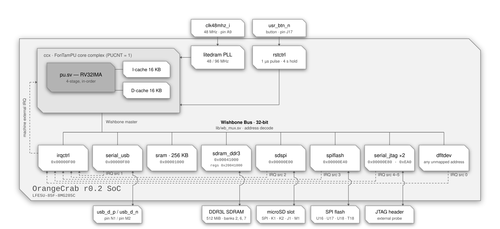

<div align="center">

# RV32 SoC — OrangeCrab r0.2 85F

**A single-core RISC-V system-on-chip built around the FonTamPU (`ftpu`) core complex,
targeting the OrangeCrab r0.2 85F.**


</div>

---

## Contents

- [Overview](#overview)
- [Block diagram](#block-diagram)
- [At a glance](#at-a-glance)
- [Memory map](#memory-map)
- [Device registers](#device-registers)
- [Interrupts](#interrupts)
- [CPU configuration](#cpu-configuration)
- [Clocking](#clocking)
- [Reset behaviour](#reset-behaviour)
- [Pin assignment](#pin-assignment)
- [Building the bitstream](#building-the-bitstream)
- [Loading a program](#loading-a-program)
- [Files](#files)
- [Notes and gotchas](#notes-and-gotchas)

---

## Overview

`orangecrab0285.sv` is the top level of a compact RV32 SoC: one `ftpu` hart with private
instruction and data caches, a Wishbone peripheral interconnect, an interrupt
controller, a USB console and a second serial port over the same USB link, a SPI master
on the microSD slot, a second SPI master on the configuration flash, 256 KB of on-chip
SRAM, the 512 MiB DDR3L SDRAM of the board through a LiteDRAM controller, and a
*default device* that acknowledges and reports every access to an address no other
device maps.

The program is in the block RAM of the SRAM from the configuration of the FPGA on, so
the SoC boots straight into application code at `0x1000`; the build writes it into the
placed and routed design, which is why changing it takes seconds, not a synthesis (see
[Loading a program](#loading-a-program)). That program can be
[`apps/bootldr`](apps/bootldr), a bootloader which initializes and calibrates the DDR3
SDRAM, then loads the application from the SPI flash or the SD card, so that the
application changes without a new bitstream and can use the DDR3 SDRAM.

---

## Block diagram

<p align="center">
  
</p>

<div align="center">
<sub>Solid lines are Wishbone, clock/reset and I/O paths · dashed lines are interrupt paths</sub>
</div>


---

## At a glance

| | |
| :--- | :--- |
| **Board** | OrangeCrab r0.2 85F |
| **FPGA** | Lattice ECP5 `LFE5U-85F-8MG285C` |
| **Harts** | 1 (`CPU_COUNT = 1`) |
| **ISA** | RV32IMA + Zicsr, Machine and Supervisor privilege |
| **Pipeline** | 4-stage in-order, single issue, branch / JAL / RET prediction |
| **Core & bus clock** | 48 MHz, from the PLL of the DDR3 controller |
| **Bus** | Wishbone, 32-bit data (`XWORDBITSZ = 32`), single master |
| **Caches** | 16 KB I-cache + 16 KB D-cache, direct-mapped |
| **RAM** | 256 KB on-chip block RAM (`SRAM_KBSIZE = 256`) and 512 MiB of DDR3L SDRAM |
| **DDR3 SDRAM** | Micron MT41K256M16, 512 MiB at `0x00041000`, through LiteDRAM (ECP5DDRPHY at 96 MHz, 192 MT/s); initialized and calibrated by `apps/bootldr` |
| **Console** | USB serial port (CDC-ACM, full speed) on the USB-C connector of the board, 2 KB RX + 2 KB TX buffers; a second one, port 1, over the same USB link, with buffers of its own |
| **SD card** | SPI master on the microSD slot, mode 0, 400 kbps at reset, up to 24 Mbps, 2 KB RX + 2 KB TX buffers |
| **SPI flash** | Second SPI master on the configuration flash, a 16 MiB Winbond W25Q128JV: `cs` high during control words, `miso` sampled on the falling edge, `sclk` through `USRMCLK`, up to 24 Mbps, 2 KB RX + 2 KB TX buffers |
| **Unmapped access** | Acknowledged by `dfltdev`: reads as `nop`, writes dropped, IRQ source 0 raised, address latched at `0xFFFFFFFC` |
| **Interrupt sources** | 5 — `dfltdev` (0), `serial_usb` port 0 (1), `sdspi` (2), `spiflash` (3), `serial_usb` port 1 (4) |
| **Reset vector** | `0x00001000` |
| **Initial `sp`** | `0x00041000` (end of the SRAM); bootldr gives its payload the end of the DDR3 SDRAM, `0x20041000`, in `a1` |
| **Toolchain** | Yosys · nextpnr-ecp5 · Project Trellis (`ecpbram`, `ecppack`) · dfu-util · `riscv32-unknown-elf` GCC |

---

## Memory map

All bases and sizes below are **byte** addresses. The interconnect table in
`orangecrab0285.sv` (`WBPI_SDEVS`) stores them as byte values and `lib/wb_mux.sv`
converts them to word indices internally.

| # | Device | Module | Base | Last | Size | Cached |
| :-: | :--- | :--- | :--- | :--- | ---: | :-: |
| 0 | Interrupt controller | `dev/irqctrl.sv` | `0x00000F00` | `0x00000F03` | 4 B (1 word) | no |
| 1 | USB console, ports 0 and 1 | `dev/serial_usb.sv` | `0x00000F80` | `0x00000F8F` | 16 B (4 words) | no |
| 2 | SRAM | `dev/sram.sv` | `0x00001000` | `0x00040FFF` | 256 KB | yes |
| 3 | DDR3 SDRAM | `rv32-orangecrab0285/dev/sdram_ddr3.v` | `0x00041000` | `0x20040FFF` | 512 MiB | yes |
| 4 | DDR3 controller registers | `rv32-orangecrab0285/dev/sdram_ddr3.v` | `0x20041000` | `0x20050FFF` | 64 KiB | no |
| 5 | SD card (SPI mode) | `dev/spi.sv` | `0x00000E00` | `0x00000E07` | 8 B (2 words) | no |
| 6 | SPI flash | `dev/spi.sv` | `0x00000E40` | `0x00000E47` | 8 B (2 words) | no |
| 7 | Default device | `dev/dfltdev.sv` | *every other address* | — | — | no |
| ↳ | Fault address register | `dev/dfltdev.sv` | `0xFFFFFFFC` | `0xFFFFFFFF` | 4 B (1 word) | no |

```
 0x00000000        · · · unmapped → dfltdev · · ·    address 0 included
 0x00000DFF
 0x00000E00 ┌────────────────────────────────────┐
            │   sdspi · 8 B                      │   0xE00 data · 0xE04 command
 0x00000E07 └────────────────────────────────────┘
 0x00000E08        · · · unmapped → dfltdev · · ·
 0x00000E3F
 0x00000E40 ┌────────────────────────────────────┐
            │   spiflash · 8 B                   │   0xE40 data · 0xE44 command
 0x00000E47 └────────────────────────────────────┘
 0x00000E48        · · · unmapped → dfltdev · · ·
 0x00000EFF
 0x00000F00 ┌────────────────────────────────────┐
            │   irqctrl · 4 B                    │
 0x00000F03 └────────────────────────────────────┘
 0x00000F04        · · · unmapped → dfltdev · · ·
 0x00000F7F
 0x00000F80 ┌────────────────────────────────────┐
            │   serial_usb · 16 B                │   0xF80/0xF88 data · 0xF84/0xF8C command
 0x00000F8F └────────────────────────────────────┘
 0x00000F90        · · · unmapped → dfltdev · · ·
 0x00000FFF
 0x00001000 ┌────────────────────────────────────┐   reset vector = 0x00001000
            │                                    │
            │   SRAM · 256 KB · cacheable        │   .text .data .bss
            │                                    │
 0x00040FFF └────────────────────────────────────┘   sp starts at 0x00041000
 0x00041000 ┌────────────────────────────────────┐
            │                                    │
            │   DDR3 SDRAM · 512 MiB · cacheable │   once bootldr initialized it
            │                                    │
 0x20040FFF └────────────────────────────────────┘   a1 from bootldr: 0x20041000
 0x20041000 ┌────────────────────────────────────┐
            │   litedram registers · 64 KiB      │   litedram_init()
 0x20050FFF └────────────────────────────────────┘
 0x20051000        · · · unmapped → dfltdev · · ·
 0xFFFFFFFB
 0xFFFFFFFC ┌────────────────────────────────────┐
            │   dfltdev · fault address · 4 B    │   read OK · write faults
 0xFFFFFFFF └────────────────────────────────────┘
```

### How the decode works

`WBPI_ADDRLIMIT` is `0x1000 + 256 KB + 512 MiB + 64 KiB = 0x20051000`, and the
interconnect sizes its address bus from that: only bits `[29:2]` of the byte address
are carried, with bits `[31:30]` OR-reduced into a single extra "out of range" bit so
**nothing aliases back into a real device** for any access at or above `0x40000000`.

Slave 7 (`dev/dfltdev.sv`) is the catch-all for every address the table does not
claim. It never drives `bsy` and acknowledges every access on the following cycle,
so **an unmapped access always completes**. A read returns the instruction `nop`
(`0x00000013`) and a write is dropped. Both are faults: the address is latched in
the fault address register and interrupt source 0 is raised (see
[Device registers](#default-device--every-unmapped-address)). The only access
to unmapped space that is *not* a fault is a read of the fault address register
itself, at `0xFFFFFFFC`.

Decode is a sequential walk of `WBPI_SDEVS` (`lib/wb_mux.sv`): when an address falls
outside the currently selected device's range, the interconnect — once any
outstanding acknowledgements have drained — restarts at entry 0 and advances one
entry per cycle, holding the bus busy, until it finds the range containing the
address or exhausts the table (which selects the default device). Back-to-back
accesses within one device cost nothing extra; alternating between, say, the USB
console and the SRAM re-walks the table at every switch. The DDR3 SDRAM and the
registers of its controller are the entries right after the SRAM; the SPI master of
the SD card and the SPI flash, although mapped below the others, come last, so that
adding them left the walk to the interrupt controller, the USB console and the SRAM as
short as it was. The default-device selection is valid only for the address it was
walked for: another address presented in that cycle restarts the walk rather than
being handed the default device.

> [!NOTE]
> The core marks everything outside `[0x1000, 0x20041000)`, the SRAM and the DDR3
> SDRAM, as non-cacheable (`cpu_dcache_miss_w`), so device registers — those of the
> DDR3 controller and the fault address register included — are always accessed
> straight through the bus and never sit stale in the D-cache.

> [!NOTE]
> The Verilator simulator (`rv32-sim/`) has no default device: its default slave
> never acknowledges, so the same access ends the simulation with a default-slave
> trap instead of raising an interrupt. Interrupt source 0 is reserved there so
> that source numbering matches the FPGA tops.

---

## Device registers

### Interrupt controller — `0x00000F00`

A single 32-bit register. A **write** submits a command, a subsequent **read**
retrieves its result; two memory operations are always needed.

| Word | Layout |
| :--- | :--- |
| write | `arg[31:2]` · `cmd[1:0]` |
| read | `resp[31:3]` · `rsvd[2]` · `cmd[1:0]` |

| `cmd` | Name | Purpose |
| :-: | :--- | :--- |
| `0b00` | `CMDDEVRDY` | Ready the controller for a new command; clears `resp` |
| `0b01` | `CMDACKIRQ` | Acknowledge an IRQ for destination `arg[31:3]`; `arg[2]` enables/disables further delivery. Returns `-1` if raised by `CMDINTDST` (served first), otherwise the source index, or `-2` if none pending |
| `0b10` | `CMDINTDST` | Raise an interrupt at destination `arg[31:3]` (used for IPIs), held pending for it until it acknowledges it; one raised while one is already pending merges with it, hence the command is never refused. The destination `-1` (all ones) requests a system reset instead |
| `0b11` | `CMDENAIRQ` | Enable (`arg[2] = 1`) or disable a given interrupt source `arg[31:3]` |

The controller has accepted a command only when the `cmd` field read back is
`CMDDEVRDY`; otherwise resend `CMDDEVRDY`. Any non-`CMDDEVRDY` command written while
a transaction is in flight is silently dropped, so use an atomic read-modify-write
to stay thread-safe.

Every source and every destination is **disabled at reset**; no source interrupt is
delivered until software enables the source with `CMDENAIRQ` and the destination with
`CMDACKIRQ` (`arg[2] = 1`). An interrupt raised with `CMDINTDST` bypasses both enables.

A `CMDINTDST` targeting the destination `-1` (`arg[31:3]` all ones) is a **system
reset request**: the controller pulses its `rst_rqst_o` output to the reset
controller, which restarts its reset pulse, so every CPU, cache and device but the
USB console and the DDR3 controller resets, and the SoC boots again from `0x1000` with
its memory contents intact (see
[Reset behaviour](#reset-behaviour)). The command's result is `-1`, as for any
invalid destination; underLineOS exposes it as `_sysreset()`.

### USB console — `0x00000F80`

`dev/serial_usb.sv` is a USB full-speed device on the USB-C connector of the board,
with two serial ports here (`SERIAL_PORTCOUNT = 2`): the host sees a composite device
(VID:PID `1d50:6149`) with a CDC-ACM serial port, and its interface association, per
port, ie: `/dev/ttyACM0` and `/dev/ttyACM1` on Linux. Port `p` has the registers and
commands of a UART console, save `CMDSETSPEED`, at `0xF80 + 8·p`:

| Offset | Address | Register | Description |
| :-: | :--- | :--- | :--- |
| `+0x0` | `0x00000F80` | Data, port 0 | Read receives one byte, write transmits one byte |
| `+0x4` | `0x00000F84` | Command, port 0 | Write submits a command, read retrieves the result |
| `+0x8` | `0x00000F88` | Data, port 1 | As the data register of port 0 |
| `+0xC` | `0x00000F8C` | Command, port 1 | As the command register of port 0 |

| `cmd` | Name | Purpose |
| :-: | :--- | :--- |
| `0b00` | `CMDDEVRDY` | Make the device accept a new command |
| `0b01` | `CMDGETBUFFERUSAGE` | `arg = 0` → RX bytes used, `arg = 1` → TX bytes used |
| `0b10` | `CMDSETINTERRUPT` | `arg = 0` disables; non-zero enables and sets the RX-usage threshold. Returns the buffer size |
| `0b11` | `CMDSETSPEED` | `arg` is ignored, the transfer rate being the host's. Returns `PHYCLKFREQ`, 48000000 |

Defaults, for each port: 2048-byte RX and TX buffers (`BUFSZ = 2048`), **interrupt
disabled** — after a reset of the device, which neither the button nor `_sysreset()`
makes (see [Reset behaviour](#reset-behaviour)).

> [!IMPORTANT]
> Reading the data register while the receive buffer is empty holds `wb_bsy_o` — the
> read **blocks** until a byte arrives. Writing it while the transmit buffer is full
> blocks likewise, until the host takes the bytes waiting, which it does only while a
> program has the port open: a program which writes more than the buffer holds before
> a terminal opens the port stalls until one does.

Port 0 raises interrupt source 1 and port 1 source 4: the sources of the ports past
port 0 follow those of the other devices (`IRQ_SERIALX`), so that the SD card and the
SPI flash keep the sources they have on the main branch. underLineOS's console is port
0; port 1 is reached through `hwdrvchar.h` at `0xF88`, or carries the gdb stub (see
[Loading a program](#loading-a-program)).

### SD card (SPI mode) — `0x00000E00`

`dev/spi.sv`, instance `sdspi`, is a SPI master in mode 0 (`CPOL = 0`, `CPHA = 0`) on the
microSD slot of the board, which it drives in SPI mode: `sclk` on the CLK of the card,
`mosi` on its CMD, `miso` on its DAT0 and `cs` on its DAT3. It transfers a 32-bit word
at a time, most significant bit of least significant byte first: a buffer in memory goes
out, and comes in, in address order. Its registers and commands are those of the USB
console, so the character-device driver `hwdrvchar.h` drives it, every count in bytes,
with `HWDRVCHAR_DATATYPE` defined to `uintptr_t` before including it, so that
`hwdrvchar_read()` and `hwdrvchar_write()` access the data register a word at a time:

| Offset | Address | Register | Description |
| :-: | :--- | :--- | :--- |
| `+0x0` | `0x00000E00` | Data | Write transmits one word, byte 0 first; read receives one, the first byte received in byte 0. `wb_sel_i` is ignored: a byte or halfword access still moves a whole word |
| `+0x4` | `0x00000E04` | Command | Write submits a command, read retrieves the result |

| `cmd` | Name | Purpose |
| :-: | :--- | :--- |
| `0b00` | `CMDDEVRDY` | Make the device accept a new command |
| `0b01` | `CMDGETBUFFERUSAGE` | `arg = 0` → RX bytes used, `arg = 1` → TX bytes not yet transmitted, counting a paused transmission and a pending close, capped to the buffer size, `0` only when no transmission is in progress; both are multiples of 4 |
| `0b10` | `CMDSETINTERRUPT` | `arg = 0` disables, and **closes** the transmission in progress; non-zero enables and sets the RX-usage threshold in bytes, a threshold between two multiples of 4 being reached at the greater one. Returns the buffer size in bytes |
| `0b11` | `CMDSETSPEED` | `arg = PHYCLKFREQ / bitrate`; sets the highest bitrate `48 MHz / 2n` not above `48 MHz / arg`, from 24 Mbps down to about 100 kbps, `arg = 0` selecting the lowest. Returns `PHYCLKFREQ` |

Reset defaults: **400 kbps**, 2048-byte (512-word) RX and TX buffers (`BUFSZ = 512`),
**interrupt disabled**. At 48 MHz, `CMDSETSPEED` for 12 Mbps takes
`48000000 / 12000000 = 4`.

Transfers are full duplex: while a word written is transmitted on `mosi`, a word is
received from `miso` into the RX buffer. The word written while the TX usage is `0`
begins a **transmission**, which lasts, `cs` low, until it is **closed** with
`CMDSETINTERRUPT` and a null `arg`: it then ends once every word written before that
command has been transmitted. When the TX buffer runs empty before, the transmission
**pauses** — `sclk` idle, `cs` kept, nothing clocked — until the next word written
resumes it, so the words can be written at any pace, preemption included. A close
while no transmission is in progress does nothing, hence the `CMDSETINTERRUPT` which
ends `hwdrvchar_init()` is harmless. The first word of a transmission is a **control
word**: 32 ones are transmitted in its place, the word received meanwhile is kept as
any other, and bits 0 – 3, the low half of its first byte in transmission order,
configure the transmission:

| Bit | When `0` |
| :-: | :--- |
| 0 | Before counting the bits transmitted, wait for a `0` bit on `miso`, `sclk` toggling meanwhile with `mosi` high — ie: the start bit of an SD card's response or data token |
| 1 | Discard that `0` bit, so that the word received in place of the control word is the 32 bits after it, otherwise that `0` bit is its bit 7; ignored unless bit 0 is `0` |
| 2 | Keep `cs` **high** for the whole transmission — ie: `0xFFFFFFFB` followed by two `0xFFFFFFFF`, then the close, sends 96 clock cycles with `cs` and `mosi` high, covering the 74 at least which an SD card needs before its first command |
| 3 | **Receive flow control**: while the RX buffer holds 2044 bytes (511 words) or more, pause instead of taking the next word, so that nothing received is dropped; the control word itself waits for room. The RX usage then stops at 2044, or at 2048 when the next word was already waiting, so use an interrupt threshold of at most 2044 |
| 4 – 31 | Reserved; write `1` |

Hence `0xFFFFFFFF` begins a plain transmission, `0xFFFFFFF7` one with flow control,
and `0xFFFFFFFB` one with `cs` high; a byte store to `0x00000E00` which begins a
transmission makes a control word whose byte 0 is that byte. A transaction goes as
follows:

```c
#define HWDRVCHAR_DATATYPE uintptr_t           // a word per access of the data register
#include "hwdrvchar.h"
uintptr_t junk[16], c;
// Prologue: end whatever is left open, drop stale responses, wait until idle.
hwdrvchar_interrupt(dev, 0);
do hwdrvchar_read(dev, junk, sizeof(junk)); while (hwdrvchar_writable(dev) != dev->bufsz);
while (hwdrvchar_read(dev, junk, sizeof(junk)));
c = 0xffffffff;                                // plain; 0xfffffff7 = receive flow control, 0xfffffffb = cs high
hwdrvchar_write(dev, &c, sizeof(c));
/* hwdrvchar_write()/hwdrvchar_read() at any pace, preemptible; read every expected response,
   e.g. SD: command, poll R1 with 0xff, poll the data token, read the block and its CRC */
hwdrvchar_interrupt(dev, 0);                   // close (re-arm the interrupt afterwards if used)
while (hwdrvchar_writable(dev) != dev->bufsz); // ended
```

Waiting for the `0` bit is given up after **100 ms**, and so is a pause, whether it
waits for a word to be written or for room in the RX buffer, as is a control word
waiting for room: the transmission is aborted with `cs` high, and no interrupt is
raised. The words still buffered, and every word written afterwards, are then
**discarded until the close**, so that a writer resuming after the abort never has a
data word taken for a control word; the words received before remain. Software sees
the TX usage return to `0` before its close, which never happens while a
transmission is in progress. A transmission left open thus ends by itself:
`hwdrvchar_init()` alone returns the device to idle, its final command ending the
discard.

> [!IMPORTANT]
> Close every transaction, and begin it with the prologue above: a transaction begun
> within 100 ms of another left open goes out as that one's data, control word
> included. The next transaction cannot be queued behind a close: wait for the TX
> usage to reach `0`. Without flow control, every word written yields a word received
> and the RX buffer drops what arrives while it is full, so keep the bytes written
> less the bytes read within 2048. `CMDSETINTERRUPT 0` within a transaction ends it;
> to silence the interrupt without closing, set a threshold of 2049, never reached.
> Under flow control, write no more than `hwdrvchar_writable()` allows, as
> `hwdrvchar_write()` does: a write stalled on a full TX buffer while the transmission
> waits for the reader holds the bus until the 100 ms timeout. Reads and writes of the
> data register block as the USB console's do. With a `HWDRVCHAR_DATATYPE` of a byte,
> each access would move a whole word, and the reads beyond the words received would
> wait for a word which, once nothing written remains to be received, never comes.

The driver `hwdrvsdspi.h` (in `ftpu/sw`) drives an SD card through it, a transaction
per command. [`rv32-nexysa7100/apps/sdcardtest`](../rv32-nexysa7100/apps/sdcardtest),
the benchmark of an SD card, uses it once built with `SDCARDTEST_MODE=0`, its other
defaults, the address `0xe00` and the interrupt source 2, being those of this top.

### SPI flash — `0x00000E40`

A second `dev/spi.sv`, `spiflash`, drives the configuration flash of the board, a
Winbond W25Q128JV of 16 MiB, through single-bit commands. Its registers, commands,
buffers, control word and transactions are those of the
[SD card](#sd-card-spi-mode--0x00000e00) above, with these differences:

| | |
| :--- | :--- |
| `CTRLCSHIGH = 1` | `cs` is **high** while the 32 ones are transmitted in place of the control word, and falls one clock cycle after their last falling edge of `sclk`, a full half-period before the next rising edge: the flash, which takes the first byte after the fall of its chip select for an instruction, is sent nothing before the command |
| Byte 1 of the control word | The count of bytes, after the control word, during which `cs` is low: `cs` rises on the falling edge of `sclk` which ends the last of them, and stays high to the end, `sclk` and `mosi` going on; `0xFF`, the reserved value, keeps it low until the end, `0x00` never lets it fall. Hence `0xFFFF01FF` followed by `0xFFFFFF06` sends WRITE ENABLE alone, `cs` rising right after its eighth bit, as the flash requires, the other three bytes being clocked with `cs` high |
| `LATESAMPLE = 1` | `miso` is sampled on the falling edge of `sclk` which ends each bit, instead of the rising edge which begins it: the flash changes its output on the falling edge, and sampling it there leaves the output delay of the pad, the clock-to-output of the flash and the input delay a full period, 41.7 ns at 24 Mbps, instead of half of one. It is not for an SD card in high speed mode, which changes its output on the rising edge |
| Clock | `sclk` reaches the flash as the configuration pin `MCLK` (pin `U16`), a dedicated pin which the lpf does not place, through the `USRMCLK` primitive |
| Control bit 0 | Must remain `1`: the wait for a `0` bit would happen with `cs` high, on a flash not selected, until the 100 ms timeout, and the bit would be sampled on the wrong edge |

The driver `hwdrvspiflash.h` (in `ftpu/sw`) reads with READ (`03h`), writes with
PAGE PROGRAM (`02h`), each page preceded by WRITE ENABLE (`06h`), and checks the
status register with READ STATUS REGISTER (`05h`), sending WRITE DISABLE (`04h`)
where a write is refused; it never erases. A page program only clears bits, so a
write leaves null the bits which were null: write locations erased by other means,
or data clearing bits only — writing back the data read leaves the flash unchanged,
which `apps/spiflashtest` does, benchmarking the 4 MiB which follow the first 2 MiB
and checking them with CRC32s.

> [!WARNING]
> The flash holds foboot, the DFU bootloader of the board, in its first 512 KiB, then,
> from `0x80000`, the bitstream which foboot starts; the data of `apps/bootldr` begins
> at 2 MiB, past the end of the bitstream, which `tools/stitch_dfu.py` checks. A write
> over foboot or the bitstream corrupts it.

### DDR3 SDRAM — `0x00041000`

`rv32-orangecrab0285/dev/sdram_ddr3.v` maps the DDR3L SDRAM of the board, a Micron
MT41K256M16 of 512 MiB, at `0x00041000` – `0x20040FFF`, and the registers of its
controller at `0x20041000` – `0x20050FFF`. The controller is LiteDRAM, which LiteX
generated in `litedram/litedram.v` from the configuration in its header,
`examples/orangecrab0285.yml`, written from that of microwatt: its ECP5DDRPHY runs the
DDR3 SDRAM at 96 MHz, ie: 192 MT/s (CL 6), its nominal termination disabled, and its
native user port, 128 bits wide, takes up to 8 accesses at a time from the 32-bit bus
through `lib/wb_upsizr.sv` and `lib/wb_litedram.sv`, its registers through
`lib/wb_classic.sv`. The D-cache of the core caches the DDR3 SDRAM as it does the SRAM;
`sdram_ddr3.v` can put a data cache of 32 KiB of its own in front of the controller
(`USECACHE`), which the top leaves out.

The DDR3 SDRAM must be initialized and calibrated before it is used:
`litedram_init()` of `litedram/litedram.c`, which `apps/bootldr` calls before it loads
the application, does so through those registers, printing its read leveling, and
fails when it finds no read window, which stops bootldr. An access made before is
not held: the controller completes it on the DDR3 SDRAM uninitialized. The reset of the
system (the button, `_sysreset()`) does not reset the controller, so that the DDR3 SDRAM
keeps its content across it. The controller is reset at the configuration of the FPGA,
when its PLL loses its lock, and when the DLL of its PHY locks anew, which also resets
the system, the delays and bitslips of its PHY, and the DDR3 SDRAM, whose reset it holds
low: the next accesses complete on it uninitialized, which nothing initializes again.

### Default device — every unmapped address

`dev/dfltdev.sv` owns every address the table does not claim. It has one register,
the **fault address register**, read from the last word of the address space:

| Address | Access | Behaviour |
| :--- | :-: | :--- |
| `0xFFFFFFFC` | read | Returns the address of the **first** fault since the register was last read. Not a fault. |
| any other unmapped address | read | Returns `0x00000013` (`nop`); **fault** |
| any unmapped address, `0xFFFFFFFC` included | write | Dropped; **fault** |

A fault raises interrupt source 0 and, if no earlier fault is still waiting to be
read, latches its address. The request is held until it is acknowledged through
`irqctrl` (`CMDACKIRQ`); faults meanwhile keep it raised but are not reported
separately, save one landing in the very cycle of the acknowledgement, which raises
a fresh request. The register can also simply be polled — the address is latched
whether or not source 0 is enabled.

The value read is the address **as seen on the bus**, sign-extended: bits `[29:2]`
are exact, bit `30` is the OR of bits `[31:30]` of the faulting address and is
replicated into bit `31`, and bits `[1:0]` always read zero (the bus carries word
addresses, so the byte offset of the access is lost). Hence:

| Faulting address | Reads back as |
| :--- | :--- |
| below `0x40000000` (fits the address bus) | exactly |
| `0xC0000000` – `0xFFFFFFFF` (a small negative pointer) | exactly |
| anything else | a negative value whose bits `[29:2]` are the faulting address's — the exact address is not recoverable |

Two details worth knowing:

- The register is **not cleared** by the read: it keeps the last latched address
  (`0` after reset) until the next fault overwrites it.
- Because only bits `[29:2]` and the OR bit travel on the bus, `0xFFFFFFFC` is the
  canonical address of the register but not the only one that reaches it: any
  address whose bits `[29:2]` are all ones and whose bits `[31:30]` are not all zero
  does. Use `(uintptr_t)-4`.

---

## Interrupts

The SoC instantiates `IRQSRCCOUNT = 5` sources and `IRQDSTCOUNT = CPU_COUNT = 1`
destination.

### Sources

| Index | Source | Constant | Raised when |
| :-: | :--- | :--- | :--- |
| 0 | `dfltdev` | `IRQ_DFLTDEV` | Any access to an unmapped address, other than a read of the fault address register |
| 1 | `serial_usb` port 0 | `IRQ_SERIAL` | RX buffer usage of port 0 reaches the threshold set by its `CMDSETINTERRUPT` |
| 2 | `sdspi` | `IRQ_SDSPI` | RX buffer usage reaches the threshold set by `CMDSETINTERRUPT` |
| 3 | `spiflash` | `IRQ_SPIFLASH` | RX buffer usage reaches the threshold set by `CMDSETINTERRUPT` |
| 4 | `serial_usb` port 1 | `IRQ_SERIALX` | RX buffer usage of port 1 reaches the threshold set by its `CMDSETINTERRUPT` |

Source 0 is reserved for the default device by convention on every top in the
repository, including `rv32-sim/` where it never fires.

### Destinations

| Index | Destination |
| :-: | :--- |
| 0 | hart 0 |

### Delivery

`irqctrl` dispatches to destinations round-robin, preferring any whose
`irq_dst_pri_i` is high (driven by each hart's `halted_o`, so halted harts are
favoured); the lowest index wins ties. At the core, a dispatched interrupt arrives
as a **machine external interrupt (MEI)**, or as **SEI** when the corresponding
`MIDELEG` bit is set.

| Mechanism | Where it lives |
| :--- | :--- |
| External interrupt (MEI / SEI) | `dev/irqctrl.sv`, memory-mapped at `0x00000F00` |
| Timer interrupt (MTI / STI) | CSRs `mtimecmp` `0x34D` and `mtimecmph` `0x35D` for MTI, or, while `MIDELEG` delegates the timer interrupt, `stimecmp` `0x14D` and `stimecmph` `0x15D` for STI — **not** memory-mapped |
| Software interrupt (MSIP / SSIP) | **not implemented**; use `CMDINTDST` for IPIs |

> [!NOTE]
> There is no CLINT and no PLIC. The timer compare registers are ordinary CSRs, and
> `time`/`cycle` are read from the same counter. Vectored interrupts are not
> supported. Simultaneous interrupts are taken in the order MEI, SEI, MTI, STI.

Three behaviours worth coding around:

- **Acknowledge promptly.** `irqctrl` dispatches source interrupts one at a time for
  all destinations; until the current one is acknowledged with `CMDACKIRQ` it cannot
  dispatch another. Interrupts raised with `CMDINTDST` are held per destination instead.
- **The USB console and SPI interrupts disarm themselves.** Each is disabled at reset
  (so no spurious interrupt can fire immediately after release) and disabled again each
  time a raised interrupt is acknowledged, so the handler must re-enable it. The USB
  ports being reset neither by the button nor by `_sysreset()`, their interrupts, their
  thresholds and their buffers survive them: an interrupt a port had armed before can be
  raised as soon as software enables its source, 1 or 4, again. On both SPI devices,
  `CMDSETINTERRUPT 0` also closes the transmission in progress: disable the interrupt
  within a transaction with a threshold of 2049 instead.
- **The fault interrupt is imprecise.** It arrives as an ordinary external
  interrupt, several instructions after the access that caused it, and that access
  has already completed — a load has consumed the word `0x00000013`, a store has
  been dropped, a fetch has executed a `nop`. The core has no
  instruction-access-fault, so a *speculative* instruction fetch of an unmapped
  address — a wrong-path fetch launched before the redirect that cancels it — also
  reaches `dfltdev` and reports a fault that never happened architecturally. Read
  the fault address register in the handler to find out what was touched.

---

## CPU configuration

Selected in the header of `orangecrab0285.sv`:

| Feature | Setting | Effect |
| :--- | :-: | :--- |
| `PURV32M` | on | `M` extension — `mul` / `div` / `rem` |
| `PUIMULDSP` | on | Multiplies in the `MULT18X18D` blocks of the ECP5 instead of iterative radix-4 shift-add |
| `PUIDIVDSP` | off | Divide uses the default radix-4 digit-recurrence |
| `PUPREDICTJAL` | on | JAL prediction |
| `PUPREDICTBRANCH` | on | Branch prediction, BHT 4096 entries |
| `PUPREDICTRET` | on | Return prediction, RAS 8 entries |
| `PUEARLYREDIRECTFETCH` | off | Carried commented out — would fetch a mispredicted branch target one cycle earlier (one lost slot instead of two) |
| `PUICACHEFILLBYPASS` | off | Carried commented out — would hand the fetch stage the refilled word directly (an I-cache miss costs three slots instead of four) |
| `PUDCACHEREGRQST` | off | Carried commented out — would register the D-cache request path (+1 cycle), which measured slower on this device |
| `PUDCACHEREGRESP` | on | Registers the D-cache response path (+1 cycle, better timing) |
| `PUAMOREGWB` | off | Not carried — AMO write-back computed from the live D-cache response |
| `PURV32ZBA/ZBB/ZBC/ZBS` | off | Bit-manipulation extensions disabled |
| `PURV32ZFINX` | off | No FPU — software floating point |
| `PUFDIVDSP2` / `PUFSQRTDSP2` | on | Pre-selects correctly-rounded DSP Newton-Raphson `fdiv` / `fsqrt` for a Zfinx build; inert while `PURV32ZFINX` is off |

Atomics (`lr` / `sc` / `amo*`) are always present, so the effective ISA string is
**RV32IMA**. Caches are `ICACHESZ = DCACHESZ = 16` KB with `ICACHEWAYCNT =
DCACHEWAYCNT = 1` (direct-mapped). `IMULCNT` is left at the `ccx` default of 1:
the pipelined multiplier accepts a new multiply while results queue for
write-back, so a second instance would buy no cycles.

The core is reset with `rstaddr_i = rstaddr2_i = 0x1000` and `spval_i = 0x41000`, so
execution starts at the bottom of the SRAM with the stack pointer at the top of it,
the DDR3 SDRAM being uninitialized at reset.

---

## Clocking

The PLL of the DDR3 controller, an `EHXPLLL`, turns the 48 MHz board oscillator into
the 96 MHz clock of its PHY and a 48 MHz clock for the logic which initializes the PHY;
a clock divider, `CLKDIVF`, halves the former into the 48 MHz clock of the controller.
That clock is the clock of the whole SoC — CPU, interconnect, USB, SD card and SPI flash
PHYs — which runs in that single **48 MHz** domain, so there is no clock-domain crossing
(`USEMEMCLKDOM` evaluates to 0 for a single hart with a D-cache); the USB PHY requires
exactly 48 MHz. Once the DLL of the PHY locks, the PHY stops that clock for about 0.5 µs
while it initializes, the system being reset meanwhile (see
[Reset behaviour](#reset-behaviour)).

> [!NOTE]
> `lib/ecppll_48_to_24_48_96.sv` is still instantiated, but none of its outputs is used,
> hence synthesis removes it; it is there for peripherals that need its 24, 48 or 96 MHz.

---

## Reset behaviour

`lib/rstctrl.sv` is instantiated with `RSTDURATION = 48` cycles (1 µs) and
`RSTTHRESH = 192000000` cycles (**4 s**) off `usr_btn_n` (the button of the board, pin
`J17`), which is active low. Its behaviour is deliberate and surprising the first time:

| Event | Result |
| :--- | :--- |
| Power-on / after configuration | SoC is **held in reset** — it does not start on its own |
| First press of the button | Releases reset after a 1 µs pulse; the SoC begins executing |
| Short press afterwards | **Ignored** |
| Press held ≥ 4 s | Asserts a fresh 1 µs reset pulse |
| Software request (`_sysreset()`, ie: `CMDINTDST` with the destination `-1`) | Asserts a fresh 1 µs reset pulse at once, no button hold needed |

Held while the board is plugged in, the same button starts foboot, the DFU bootloader in
the flash, instead of the bitstream (see
[Building the bitstream](#building-the-bitstream)).

The reset of the SoC also lasts until the PLL of the DDR3 controller is locked, and is
raised again while the PHY of the controller initializes, once its DLL locks. The DDR3
controller is not reset by the reset of the SoC, so that the DDR3 SDRAM keeps its content
across a press of the button and `_sysreset()`; it is reset only at the configuration of
the FPGA, when its PLL loses its lock, or when the DLL of its PHY locks anew, which also
resets the DDR3 SDRAM, whose content is then lost.

The USB device, both of its ports, is reset neither by the button nor by
`_sysreset()`, either of which would break its connection to the host: its own power-on
reset lasts from the configuration of the FPGA until 255 cycles after the reset of the
DDR3 controller was last high, so that the connection drops only when that controller
resets.

> [!TIP]
> If the board appears dead once its bitstream runs, press the button once — that is
> the intended way to start it. To reset a running system, hold the button for four
> seconds, or have the program request it with `_sysreset()`.

---

## Pin assignment

From `orangecrab0285.lpf`:

| Signal | Pin | IO type | Board signal |
| :--- | :-: | :--- | :--- |
| `clk48mhz_i` | `A9` | LVCMOS33 | 48 MHz oscillator |
| `usr_btn_n` | `J17` | SSTL135_I | The button, active low |
| `led_red_n` `led_green_n` `led_blue_n` | `K4` `M3` `J3` | LVCMOS33 | RGB LED, active low — driven high, it stays dark |
| `usb_d_p` `usb_d_n` | `N1` `M2` | LVCMOS33 | USB D+ and D− |
| `usb_pullup` | `N2` | LVCMOS33, driven high | Pull-up of D+, which makes the host see a full-speed device |
| `sdspi_sclk_o` | `K1` | LVCMOS33 | microSD slot, the CLK of the card |
| `sdspi_mosi_o` | `K2` | LVCMOS33, pull-up | The CMD of the card |
| `sdspi_miso_i` | `J1` | LVCMOS33, pull-up | The DAT0 of the card |
| `sdspi_cs_o` | `M1` | LVCMOS33, pull-up | The DAT3 of the card |
| `spiflash_cs_o` | `U17` | LVCMOS33 | `spiflash4x_cs_n` (configuration flash) |
| `spiflash_mosi_o` | `U18` | LVCMOS33 | `spiflash4x_dq[0]` |
| `spiflash_miso_i` | `T18` | LVCMOS33, pull-up | `spiflash4x_dq[1]` |
| `spiflash_wp_o` | `R18` | LVCMOS33, driven high | `spiflash4x_dq[2]` (`W#`) |
| `spiflash_hold_o` | `N18` | LVCMOS33, driven high | `spiflash4x_dq[3]` (`HOLD#`) |

The names of the board signals of the flash are those of the `gsd_orangecrab.py`
platform of litex-boards, one of the sources of the lpf. `miso` is pulled up on the SD
card and on the flash, which drive it only while selected; `mosi` and `cs` of the SD card
are pulled up as well. The clock of the flash is the configuration pin `MCLK` (`U16`), which
`USRMCLK` drives, hence no `LOCATE` in the lpf; `W#` and `HOLD#` are held high, as
single-bit commands use neither. No constraint packs the registers driving or sampling
these pins into the I/O cells.

The pins of the DDR3 SDRAM itself take the IO types of litex-boards: `SSTL135_I`,
and `SSTL135D_I` for the strobes `ddr3l_dqs_p` and the clock `ddr3l_clk_p`, whose
complements their IO type drives on the paired pins, which the lpf hence does not
locate; `SLEWRATE=FAST` on every one, `TERMINATION=OFF` on the data and the strobes, and
`DIFFRESISTOR=100` on the strobes. They span the banks 2, 6 and 7. The MT41K256M16
having 15 address bits, the 16th of the platform, `ddr3l_a[15]`, is left out.
`ddr3l_vccio` (6 pins) and `ddr3l_gnd` (2 pins), `SSTL135_II`, are pins which the
OrangeCrab r0.2 requires driven high, and low, while its DDR3 SDRAM is used, as
litex-boards drives them.

Bitstream settings: compressed, the flash read at 38.8 MHz at configuration
(`ecppack --compress --freq 38.8`).

---

## Building the bitstream

Requires the open-source ECP5 flow — Yosys, nextpnr-ecp5 and Project Trellis
(`ecpbram`, `ecppack`), ie: from the OSS CAD Suite — and dfu-util (`dfu-suffix`,
`dfu-util`).

```sh
cd rv32-orangecrab0285/yosys
make            # yosys, nextpnr-ecp5, ecpbram, ecppack, dfu-suffix: orangecrab0285.dfu
make prog       # dfu-util --alt 0 -D orangecrab0285.dfu
```

The makefile synthesizes `../orangecrab0285.sv` with `synth_ecp5`, the repository root
being its include directory — that is how the `` `include "lib/..." `` and
`` `include "cpu/..." `` directives in `orangecrab0285.sv` resolve; places and routes it
with `nextpnr-ecp5 --85k --speed 8 --package CSFBGA285` against `../orangecrab0285.lpf`;
writes the program into its block RAM with `ecpbram`; packs it with `ecppack`; and
appends with `dfu-suffix` the DFU suffix which the bootloader of the board expects,
VID:PID `1209:5af0`.

Three things the makefile does beyond the defaults:

- **A latch fails the build.** Before `synth_ecp5`,
  `select -assert-none t:$dlatch t:$dlatchsr t:$sr` stops the synthesis when `proc`
  inferred a latch.
- **Placement is retried.** nextpnr-ecp5 places with a random seed (`-r`) and fails
  when a clock misses its frequency, 48 MHz for `clk48mhz_i` and the clocks derived
  from it; the makefile then runs it again, up to `RETRY_COUNT` (10) runs in all.
  `orangecrab0285.pnr.log` keeps the last run.
- **The speed grade is 8**, that of the part, where nextpnr-ecp5 would default to 6.

`make` leaves in `yosys/` the logs of synthesis and of placement
(`orangecrab0285.synth.log`, `orangecrab0285.pnr.log`), the placed and routed
configuration with the placeholder contents of the SRAM (`orangecrab0285.bak.config`,
`orangecrab0285.sram.hex`), and the bitstream, `orangecrab0285.dfu`. The logs, the
configuration and its placeholder are committed — on this branch, those of the main
branch, whose USB device has a single port: run `make` once, to place this design,
before `make updsram` (see [Loading a program](#loading-a-program)).

To program the board, hold its button while plugging it in: foboot, its bootloader, then
waits for DFU instead of starting the bitstream, and `make prog` writes the bitstream to
the flash at `0x80000`. Plugged in again, its button released, the board starts it. The
console is then the USB port itself:

```sh
picocom -q --imap lfcrlf /dev/ttyACM0     # or screen, minicom, ...; no baud rate applies
```

---

## Loading a program

The program in the SRAM is written into the placed and routed configuration by
`ecpbram`: synthesis reads, through `$readmemh`, a random placeholder,
`orangecrab0285.sram.hex`, which `ecpbram` replaces in the configuration with the words
of `SRAM_INITFILE`. Hence **changing the program takes neither synthesis nor
placement**: `make updsram` takes the configuration in `yosys/`,
`orangecrab0285.bak.config`, and its placeholder, swaps the program in and packs the
bitstream again, in seconds — once `make` has placed this design, the configuration
committed on this branch being the main branch's, without the second port:

```sh
cd rv32-orangecrab0285/yosys
make updsram SRAM_INITFILE=../../rv32-sim/apps/helloworld/helloworld.32.hex
make prog
```

Port 1 can carry underLineOS's gdb stub, an image linked with
`-lgdbstub -Wl,--defsym=_gdbstub_dev=0xf88 -Wl,--defsym=_gdbstub_irq=4` — the stub's
defaults being the device at `0xe80`, which this top does not map, and source 1, the
console's — and gdb then opening that port, ie: `target remote /dev/ttyACM1`. The USB
device surviving `_sysreset()`, the link stays up across the soft resets of a gdb
`reload`; the underLineOS documentation (GDB stub, *Loading a new program*) describes
the procedure.

The `examples/rv32-orangecrab0285/serial_jtag` branch demonstrates two serial consoles
tunneled through the JTAG port of the ECP5.

The build knobs are variables of the makefile: it passes `CPU_COUNT`, `XWORDBITSZ` and
`SRAM_KBSIZE` to yosys as defines, in place of the `` `ifndef ``-guarded defaults at the
top of `orangecrab0285.sv`, and `SRAM_INITFILE` to `ecpbram`, yosys reading the
placeholder instead:

```make
CPU_COUNT ?= 1
XWORDBITSZ ?= 32
SRAM_KBSIZE ?= 256
SRAM_INITFILE ?= ../../rv32-sim/apps/coremark/rv32/coremark.${XWORDBITSZ}.hex
```

`SRAM_INITFILE` is relative to `yosys/`, where the makefile runs; the others change the
netlist, hence call for `make -B` with them on its command line.

The default image is CoreMark. Any application under [`rv32-sim/apps/`](../rv32-sim/apps)
— `helloworld`, `donut`, `tinyraytracer`, … — can be dropped in by
pointing `SRAM_INITFILE` at its `*.32.hex`, as can [`apps/spiflashtest`](apps/spiflashtest),
the benchmark of the SPI flash, with `../apps/spiflashtest/spiflashtest.32.hex`.

To build your own, link at `0x1000` and emit a whitespace-separated list of 32-bit
words:

```sh
riscv32-unknown-elf-gcc -O3 -Wl,-z,max-page-size=4 -o app.elf app.c
riscv32-unknown-elf-objcopy -O binary app.elf app.bin
truncate --size=%4 app.bin
hexdump -v -e '/4 "%08x "' app.bin > app.32.hex
```

The `.32.hex` suffix matters: the same makefiles also emit 64/128/256-bit variants
for wider `XWORDBITSZ` builds, and this target uses a 32-bit bus.

> [!NOTE]
> `SRAM_KBSIZE` must stay a power of two, and 256 is the most this device holds.
> Changing it moves the end of RAM, and with it `WBPI_ADDRLIMIT`, the initial stack
> pointer and the cacheable window — all of which are derived from it automatically.
> Widening `WBPI_ADDRLIMIT` also widens the address bus, and with it the window of
> addresses the fault address register reports exactly. It also moves the DDR3 SDRAM
> and the registers of its controller, which follow the SRAM, but not their address in
> `litedram/litedram.c`: build `apps/bootldr` with `-DLITEDRAM_BASE=` the new end of the
> SRAM, its default being `0x41000`, ie:
> `make clean && CFLAGS=-DLITEDRAM_BASE=0x21000 make` for 128 KB.

### From the SPI flash or the SD card: `apps/bootldr`

[`apps/bootldr`](apps/bootldr) is a bootloader baked into the SRAM in place of the
application. Started by the first press of the button, it initializes and calibrates the
DDR3 SDRAM, then reads the data at byte `0x200000` of the SPI flash, past foboot and the
bitstream, into the DDR3 SDRAM, checks the CRC32 of the payload it holds, copies the
payload to `0x1000`, and starts it with the system reset that `_sysreset()` also
requests: the CPU, its caches and the devices restart — save the USB console, which
keeps its connection — but the SRAM and the DDR3 SDRAM keep their content. The payload
gets the end of the DDR3 SDRAM, `0x20041000`, in register `a1`, which underLineOS's
`crt0.S` takes for its end of memory. Here, on the board, with
[`rv32-sim/apps/memtest`](../rv32-sim/apps/memtest) as the payload, which then tests the
memory from its heap to its stack:

```
🚀 Starting bootloader ...
Initializing SDRAM @ 0x41000...
Switching SDRAM to software control.
Read leveling:
  m0, b00: |01110000| delays: 02+-01
  m0, b01: |00000000| delays: -
  m0, b02: |00000000| delays: -
  m0, b03: |00000000| delays: -
  best: m0, b00 delays: 02+-01
  m1, b00: |01110000| delays: 02+-01
  m1, b01: |00000000| delays: -
  m1, b02: |00000000| delays: -
  m1, b03: |00000000| delays: -
  best: m1, b00 delays: 02+-01
Switching SDRAM to hardware control.
💾 SPI flash at 0xe40 | 📦 4194304 words (16.0MB) | ⚡ 24000000 bps
📍 word 524288 (2.0MB)
📥 Loaded: 18240 B (17.8KB) | ⏱️ 0.006102 s | 📊 2.9MB/s | 🔢 CRC32 0x1cb6430c ✅
🔄 Resetting into the payload at 0x1000 | 📎 a1 0x20041000: end of memory raised
🚀 Starting memory tests ...
👉 Test 1/2: writing and verifying sequence pattern ...
⏳👍⏳👍⏳👍⏳👍⏳👍⏳👍⏳👍⏳👍⏳👍⏳👍⏳👍⏳👍⏳👍⏳👍⏳👍⏳👍⏳👍⏳👍⏳👍
👉 Test 2/2: writing and verifying alternating pattern ... ⏳👍
✅ SUCCESS: all tests passed in 7309720 ms!
```

The read leveling scans, for each byte lane `m0` and `m1` of the DDR3 SDRAM and each of
the 4 bitslips of its input, the 8 steps of its input delays, a `1` marking a step at
which a pattern written then read back matched; `best:` gives the bitslip kept and the
center of its window, which a separate scan measures. A lane without a window makes
`litedram_init()` fail: bootldr then prints `❌ ERROR: __bootldr_init_array[0] failed`
and stops.

1. In `rv32-orangecrab0285/yosys`, put bootldr in the SRAM:
   ```sh
   make updsram SRAM_INITFILE=../apps/bootldr/bootldr.32.hex
   ```
2. Format the application, a `.bin` linked at `0x1000`, into `app.bldr.bin` with
   [`tools/mkBootldrDat.py`](../tools/mkBootldrDat.py):
   ```sh
   python3 ../../tools/mkBootldrDat.py -o app.bldr.bin ../../rv32-sim/apps/helloworld/helloworld.bin
   ```
   The data is the signature `"BLDR"`, the count of 32-bit words of the payload, the
   payload, then its CRC32 (zlib's).
3. Stitch it into the DFU image with [`tools/stitch_dfu.py`](tools/stitch_dfu.py), which
   pads the bitstream with `0xFF` up to the data, at `0x200000` of the flash; it fails
   when the bitstream runs past `0x200000`, or the data past `0xF80000`, where foboot
   stops writing:
   ```sh
   python3 ../tools/stitch_dfu.py orangecrab0285.dfu app.bldr.bin -o combined.dfu
   ```
4. With the board in foboot, its button held while it is plugged in, write both:
   ```sh
   dfu-util --alt 0 -D combined.dfu
   ```

From the SD card instead, the data lies at the beginning of an MBR partition of the card,
ie: written with `dd` to its second partition, `/dev/sdX2`, and bootldr is built for the
card in SPI mode, at the address of its SPI master:

```sh
cd rv32-orangecrab0285/apps/bootldr
make clean && CFLAGS='-DBOOTLDR_DEVTYPE=1 -DBOOTLDR_DEVADDR=0xe00 -DBOOTLDR_FIRSTU32=-1' make
```

`BOOTLDR_DEVADDR` cannot be left out: its default, `0xe40`, is the flash, which would
then receive the commands meant for the card. `BOOTLDR_FIRSTU32` of `-1`, `-2` or `-3`
selects the entry 1, 2 or 3 of the partition table, entries counting from 0 where fdisk
and Linux number the partitions from 1: the entry 1 is the partition 2.

The payload, read into the DDR3 SDRAM, is bounded by its medium: the flash from
`0x200000` up to `0xF80000`, 13.5 MiB, or, from the SD card, the 512 MiB of the DDR3
SDRAM. A failure, ie: a calibration of the DDR3 SDRAM which found no read window, no
data, a CRC32 mismatch or a payload too large, prints a line beginning with
`❌ ERROR:` and stops, with nothing at `0x1000` changed, so holding the button runs
bootldr again. Once the application has started, it is what sits at `0x1000`: holding
the button restarts the application, and bootldr runs again only at the next
configuration of the FPGA.

bootldr's options are `BOOTLDR_*` defines, set through `CFLAGS` and described in the
header of `bootldr.c`: the device and its driver (the SPI flash by default, the SD card
in SPI mode through `hwdrvsdspi.h`, or an SD card in SD mode through `hwdrvsdsdio.h`, on
a top with an SD host on its slot), the word where the data lies or an MBR partition of
a card, and a file of stack data, ie: a device tree blob, which bootldr embeds and
stores right below the end of memory, register `a1` giving its address to the
application, with `ra` set to -1 and `a0` to 0, which tell it from what a later reset
leaves in `a1`; underLineOS's `crt0.S` then ends memory at `a1`, at that boot and at the
warm boots which follow, and the application finds the data at `__rst_sp`. Functions
run before the load are those of `__bootldr_init_array`: by default of its `SRCS`, the
makefile compiles `bootldr_init_array.c` and `../../litedram/litedram.c`, which put
`litedram_init()` in that array; it raises `__bootldr_ram_end`, the end of memory given
to the payload, to the end of the DDR3 SDRAM. `SRCS= make` leaves the DDR3 SDRAM out,
the payload then getting at most about 212 KiB of the SRAM, or about 203 KiB from the
SD card, whose driver is larger.

---

## Files

| Path | Description |
| :--- | :--- |
| `orangecrab0285.sv` | SoC top level: build-time defaults, PLL, reset, core complex, interconnect, peripherals |
| `orangecrab0285.lpf` | Pin, IO type and clock constraints |
| `yosys/makefile` | The build: synthesis, placement and routing, the program written into the block RAM, the bitstream with its DFU suffix, and its writing through DFU |
| `yosys/orangecrab0285.bak.config` | The committed placed and routed configuration, with the placeholder contents of the SRAM, which `make updsram` reuses — on this branch the main branch's, without the second port, until `make` replaces it |
| `yosys/orangecrab0285.sram.hex` | That placeholder |
| `yosys/orangecrab0285.synth.log`, `yosys/orangecrab0285.pnr.log` | The logs of the committed build |
| `tools/stitch_dfu.py` | Places data at a flash address of a DFU image, ie: that of `apps/bootldr` at `0x200000` |
| `apps/spiflashtest/` | Benchmark and data check of the SPI flash, with copies of its drivers |
| `dev/sdram_ddr3.v` | The DDR3 SDRAM, behind `lib/wb_upsizr.sv` and `lib/wb_litedram.sv`, and the registers of its controller, LiteDRAM, behind `lib/wb_classic.sv`, with an optional data cache (`USECACHE`) |
| `litedram/` | LiteDRAM as LiteX generated it for the DDR3 SDRAM (`litedram.v`, with its configuration in its header, and `csr.h`, `sdram_phy.h`, `soc.h`), and `litedram.c`, whose `litedram_init()` initializes and calibrates it, with its headers |
| `apps/bootldr/` | Bootloader which initializes the DDR3 SDRAM and loads the application from the SPI flash or the SD card, with copies of its drivers |
| `.README.md/block_diagram.svg` | The block diagram above |

Shared sources come from the repository root: [`cpu/`](../cpu) (core complex),
[`dev/`](../dev) (Wishbone peripherals, the USB console `serial_usb.sv`, with its
`PORTCOUNT` ports, and the default device included) and [`lib/`](../lib) (PLL, reset,
FIFOs, interconnect, SPI master, the USB stack `core_usb_cdc/`, whose descriptor ROM
`PORTCOUNT` sizes, and `core_usb_fs_phy/`, the Wishbone bridges to the DDR3
controller); [`tools/mkBootldrDat.py`](../tools/mkBootldrDat.py) formats the data which
`apps/bootldr` loads.

---

## Notes and gotchas

- **Press the button once after the bitstream starts** — the SoC is held in reset until
  you do; held while the board is plugged in, the button starts foboot instead.
- **The DDR3 SDRAM needs `litedram_init()` first.** bootldr calls it; a program baked
  straight into the SRAM, ie: CoreMark, the default `SRAM_INITFILE`, must call it
  itself before it touches `0x00041000` – `0x20040FFF`, else its accesses complete on
  the DDR3 SDRAM uninitialized.
- **Unmapped accesses are reported, not trapped.** `dfltdev` acknowledges them: a
  read returns `nop`, a write vanishes, interrupt source 0 is raised and the
  address is latched at `0xFFFFFFFC`. A program that never enables source 0
  therefore runs on past a wild pointer — poll the fault address register if in
  doubt. The lowest mapped device sits at `0xE00` precisely so that a
  null-pointer access is reported rather than decoded.
- **The fault interrupt is imprecise**, and a speculative instruction fetch can
  raise it without any instruction at that address ever executing (see
  [Interrupts](#delivery)).
- **Atomics bypass the D-cache** and do not participate in cache coherency. A
  variable manipulated atomically must be accessed *only* through atomic
  instructions, and must be initialised atomically if it lives in runtime-allocated
  memory. Statically allocated variables start zeroed and are safe.
- **Do not build the toolchain with `-msave-restore`.** The millicode it calls enters
  through a `JALR` writing `x5` and returns through a `JALR` reading `x5`; the return
  address stack only recognises `x1`, so neither is predicted.
- **Set `mtvec` before anything can trap.** It resets to `0`, and a trap taken
  while the trap vector is still null halts the hart indefinitely — the board
  simply looks dead. A halted hart wakes only on an enabled, pending interrupt.
- **Build applications for `rv32ima_zicsr_zifencei`**, the default of the toolchain: the
  core does not trap every encoding of an extension it leaves out — ie: `clmul` without
  Zbc executes as a shift — so an image built for one, like `isatests` (Zba, Zbb, Zbc,
  Zbs), `clmultest` and `clmulbench` (Zbc), or `fpusmoke` and `fputests` (Zfinx), does not
  run correctly here.
- **The USB ports block both ways.** A read blocks until a byte is available, and a
  write blocks while the transmit buffer is full, until the host takes its bytes, which
  it does only while a program has that port open: writing to port 1 while nothing on
  the host has it open stalls once its transmit buffer is full.
- **The USB ports survive the button and `_sysreset()`**, their state included: their
  interrupt settings, and the bytes waiting in their buffers; only a reset of the DDR3
  controller resets them.
- **underLineOS's console is port 0 only**: `stdin` and `stdout` use `0xF80`; port 1 is
  reached through `hwdrvchar.h` at `0xF88`, or as the gdb transport.
- **`make updsram` needs a `make` first on this branch**: the committed
  `orangecrab0285.bak.config` is the main branch's placed design, so `make updsram` from
  a fresh checkout builds a bitstream whose USB device has a single port.
- **`make clean` deletes the committed build** — `orangecrab0285.bak.config` and
  `orangecrab0285.sram.hex`, which `make updsram` needs, and the logs — along with the
  rest: restore them with git, or rebuild them with `make`.
- **The build depends only on `../orangecrab0285.sv` and the lpf**, not on the files the
  top includes: after editing one of them, rebuild with `make -B`.
- **The makefile's recipes are bash** (`&>`, `((…))`, `[[ … ]]`): where `/bin/sh` is
  another shell, run `make SHELL=bash`.
- The Wishbone arbiter is not instantiated here — with a single master
  (`WBPI_MDEVCOUNT = 1`) it is optimised away. The bus downsizers named by
  `WBPI_DNSIZR` are likewise inactive, since `XWORDBITSZ == WORDBITSZ == 32`.
- For iterating on software, the Verilator model in [`rv32-sim/`](../rv32-sim) runs
  the same RTL far faster than the synthesis loop — but note it traps on an
  unmapped access where this SoC reports one.

---

<div align="center">
<sub>

SPDX-License-Identifier: **GPL-2.0-only** · © William Fonkou Tambe

</sub>
</div>
